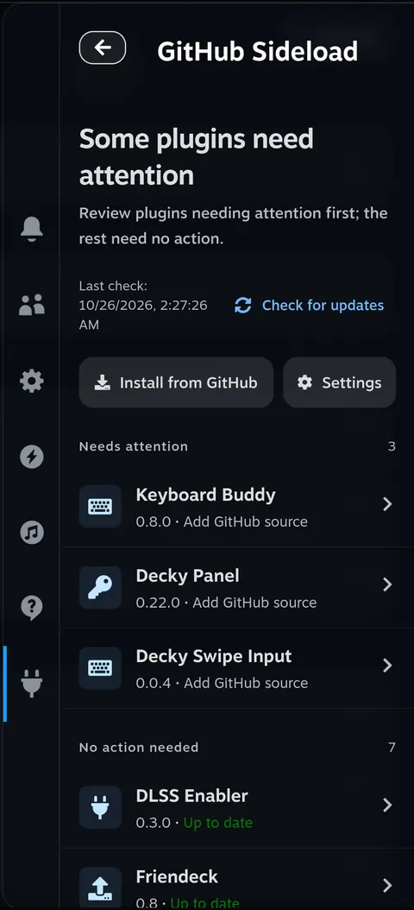
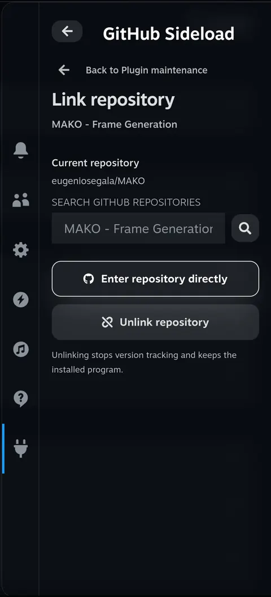
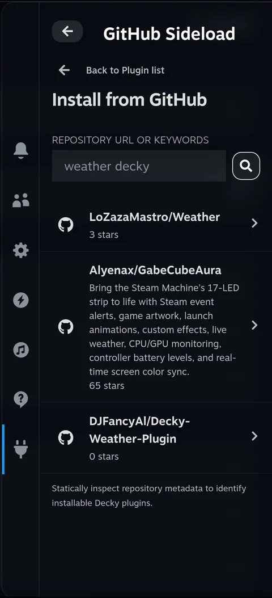
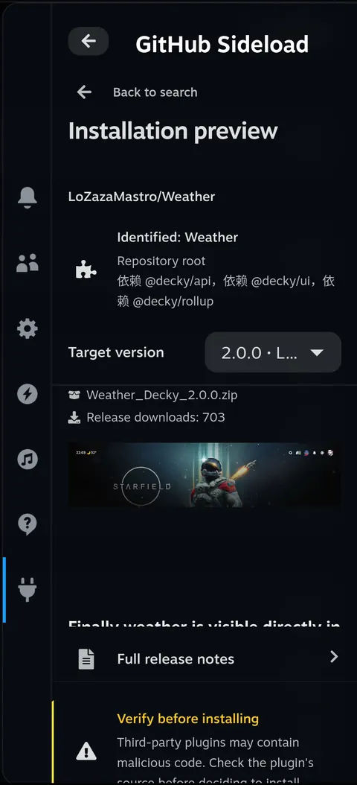
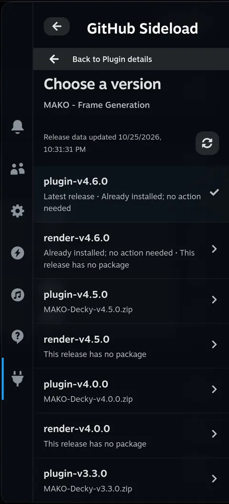
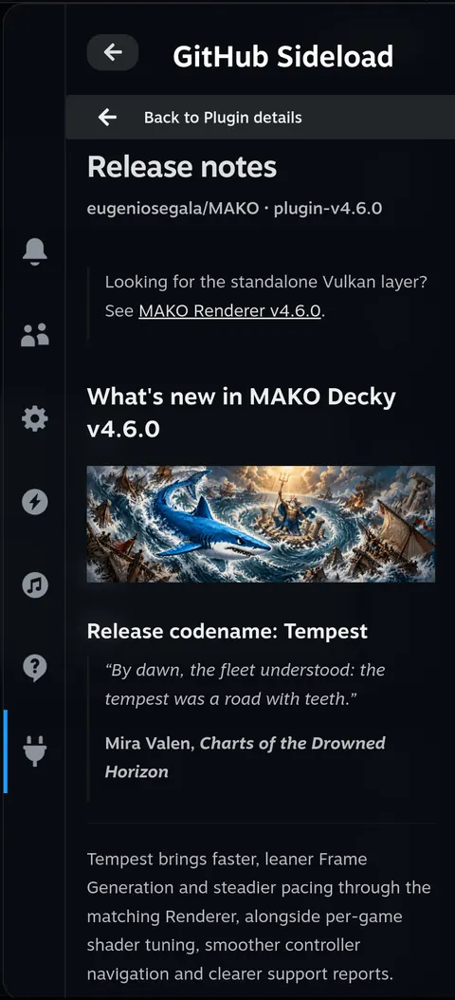
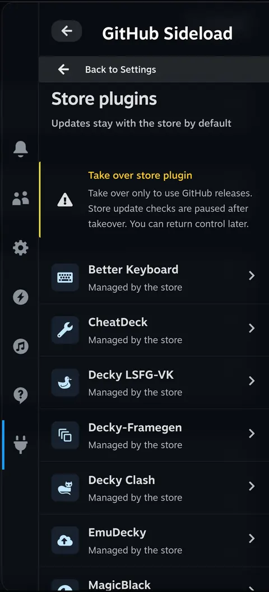
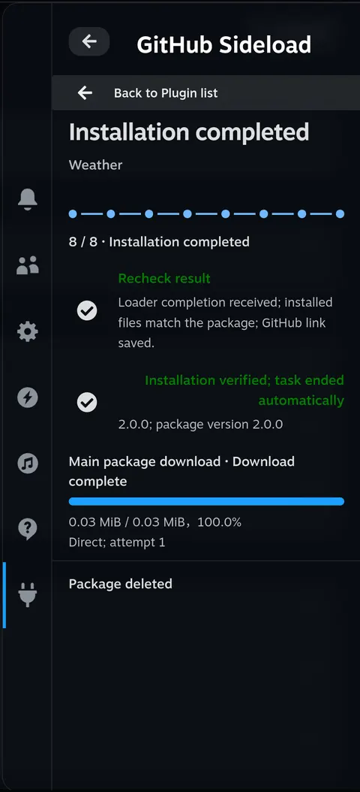
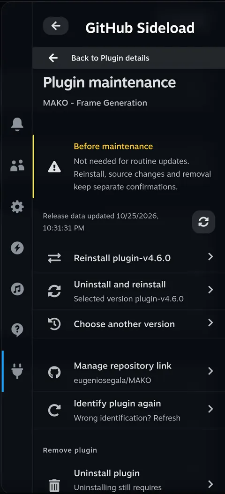

<h1 align="center">decky-sideloader</h1>

decky-sideloader is a Decky plugin for Steam Deck. It connects installed plugins to their GitHub repositories, checks releases, and lets you install, update, downgrade or reinstall through Decky's own confirmation screens. Search for a new plugin or paste its repository address, then choose the release and installation package in the Quick Access menu (QAM).

<p align="center">
  <a href="./README.md">English</a> · <a href="./docs/readme/README.zh-CN.md">简体中文</a> · <a href="./docs/readme/README.pt.md">Português</a> · <a href="./docs/readme/README.es.md">Español</a> · <a href="./docs/readme/README.ja.md">日本語</a> · <a href="./docs/readme/README.ko.md">한국어</a>
</p>
<p align="center">
  <a href="#what">What you can do</a> · <a href="#why">Why decky-sideloader</a> · <a href="#install">Install</a> · <a href="#try-it">First use</a> · <a href="#limits">Installation and backups</a> · <a href="#usage">Usage and settings</a> · <a href="#language">Language</a> · <a href="#development">Developer information</a> · <a href="./CHANGELOG.md">Changelog</a>
</p>

<p align="center">
  <a href="./assets/readme/en/home.webp"></a>
</p>

<h2 id="what">What you can do</h2>

**Keep GitHub plugins together.**

See installed versions and update results in one list. Link a missing repository by searching GitHub or entering its address. Check for updates manually, or enable scheduled checks and notifications in Settings. Checks do not install updates automatically.

<details>
<summary>Screenshots</summary>

<p align="center">
  <a href="./assets/readme/en/binding.webp"></a>
</p>
</details>

**Find and install a new plugin.**

Find a plugin using a GitHub URL, `owner/repo`, or search keywords. Repositories are checked for Decky plugin files; if several plugins are present, choose the project you want.

<details>
<summary>Screenshots</summary>

<table>
  <tr>
    <td align="center"><a href="./assets/readme/en/search.webp"></a></td>
    <td align="center"><a href="./assets/readme/en/preview.webp"></a></td>
  </tr>
</table>
</details>

**Choose the release you want.**

Read release notes, open the full Markdown document, choose another version, or skip a release.

<details>
<summary>Screenshots</summary>

<table>
  <tr>
    <td align="center"><a href="./assets/readme/en/versions.webp"></a></td>
    <td align="center"><a href="./assets/readme/en/release-notes.webp"></a></td>
  </tr>
</table>
</details>

**Keep store management separate.**

Store-managed plugins stay with the store by default. You can explicitly transfer management to decky-sideloader to use GitHub releases, then return the plugin to the store later.

<details>
<summary>Screenshots</summary>

<p align="center">
  <a href="./assets/readme/en/store.webp"></a>
</p>
</details>

**Follow the installation.**

Follow the main download, additional dependencies, preparation, native confirmation and verification on the task page. You can close QAM and reopen it to follow the same task. Successful tasks finish automatically after Loader completion and installed-file checks.

<details>
<summary>Screenshots</summary>

<table>
  <tr>
    <td align="center"><a href="./assets/readme/en/task.webp"></a></td>
    <td align="center"><a href="./assets/readme/en/maintenance.webp"></a></td>
  </tr>
</table>
</details>

<h2 id="why">Why decky-sideloader</h2>

Installing a Decky plugin from GitHub used to mean switching to Desktop Mode to download a ZIP, switching back to Gaming Mode, finding that ZIP in Decky Loader, and waiting for the installation to finish. It was a long process, with mode switches just to install one plugin.

Updates were easy to miss. We often only found out that a plugin had been updated when someone mentioned it in a video or a group chat. If the new version didn't work well, switching back to an older release—or choosing another version—was cumbersome too.

<h2 id="install">Install</h2>

### Install Decky first

Follow the official [Decky Loader installation instructions](https://github.com/SteamDeckHomebrew/decky-loader#installation) if Decky is not installed.

### Get an installation package

Build the installation ZIP using [Build from source](#build). The resulting file is in the repository's `dist/` directory: `dist/decky-sideloader-<version>.zip`.

Copy that ZIP onto your Steam Deck, then follow the steps below. GitHub's **Source code (zip)** archive contains source files, not the installable plugin.

### Install it in Decky

The following are the English labels in Decky's interface:

1. Open the Quick Access menu and select the plug icon. Return to the Decky plugin list if another plugin is open.
2. Select the gear to open **Decky Settings**.
3. In **General**, enable **Developer mode**.
4. Open **Developer**. Under **Third-Party Plugins**, select **Browse** beside **Install Plugin from ZIP File**.
5. Read Decky's confirmation and select the packaged ZIP.
6. Return to the plugin list and open **Sideloader**.

To update Sideloader itself, open **Settings → Sideloader updates**. To remove it, use **Plugins** in Decky's settings.

<h2 id="try-it">First use</h2>

Open **Sideloader** in QAM, then choose the path that matches what you want to do.

### Update an installed plugin

1. Open the plugin from Home. Supported names are linked automatically using the bundled repository map. If the link is missing or wrong, use **Manage repository link**, search or paste an address, and select **Save link**.
2. Select **Check for updates** on Home, or **Reload releases** in the plugin's details.
3. Read the release notes, select the version you want and start its installation.

### Install a new plugin

1. Select **Install from GitHub** on Home.
2. Enter a GitHub URL, `owner/repo`, or search keywords. Select the repository and, if needed, the project within it.
3. In the installation preview, choose the release and installation ZIP, then select **Continue installation**.

### Confirm and follow the installation

Follow the prompts to start preparation. If the package has installation warnings, review the confirmation dialog before continuing; then confirm installation in Decky's native window. The task page shows progress and the result; after completion, return to the plugin list.

Use **A** to activate an item and **B** to return. Search drafts, version choices and task state survive closing and reopening QAM.

<h2 id="limits">Installation and backups</h2>

### Before installing

- New-install previews show the third-party code and source warning. A selected project declaring `root` also shows **“This plugin has full access to your Steam Deck.”** This notice is not shown in installed-plugin details.
- Releases need a packaged plugin ZIP. A release without a package remains visible, but the preview does not automatically select an older release. For a repository containing several plugins, select the intended project; the downloaded ZIP is checked against that project.

### Cancellation and uninstalling first

- Cancellation is available while preparation can still be stopped. An installation already started by Loader cannot be interrupted here. Failed or unknown results are not treated as completed installations.
- **Uninstall and reinstall** prepares the package and backup before asking for permission to uninstall. Decky's installation confirmation follows after removal is verified. The target plugin's own uninstall hook can change its data.

### What is backed up and where

Before replacing another installed plugin, decky-sideloader backs up its standard Decky `settings/<folder>` and `data/<folder>` directories. Custom paths are not included, and there is no automatic restore or rollback.

The task page shows which data was backed up and where the backup is saved. The usual location is:

```text
~/homebrew/data/decky-sideloader/installations/<operation-id>/data-backup.zip
```

### Retention and cleanup

- Backups older than seven days are deleted at startup, hourly, and before preparing a new installation.
- **Settings → Delete data backups** also removes recent backups after confirmation. Active tasks and tasks with unknown results keep their backups.
- Cleanup removes backup archives only, not the original plugin data or installation packages. **Delete package after installation** is a separate setting.

<details>
<summary>Package and storage limits</summary>

| Item | Limit |
| --- | --- |
| Main plugin ZIP download | 128 MiB |
| Expanded plugin content | 512 MiB and 10,000 files |
| Each data backup | 512 MiB and 10,000 files |
| Existing task data | Above 768 MiB, a new task cannot start |

</details>

<h2 id="usage">Usage and settings</h2>

### Version selection

Details keep the last successfully loaded release list until you reload it or check for updates. Refreshing preserves a still-valid selected version; use **Choose another version** to switch to a newly discovered release.

### Plugin maintenance and store management

Open **Plugin maintenance** in a plugin's details to reinstall the same version, uninstall and reinstall, change its repository link, or remove it. Routine updates use the version actions in details.

To use a GitHub release for a store-managed plugin, open **Settings → Store plugins** and explicitly take over the plugin. This pauses its native store update checks. **Return to store** restores its previous store-update setting.

### Sideloader updates

Open **Settings → Sideloader updates → Check for Sideloader updates**. Home and scheduled checks also check Sideloader; scheduled checks follow the existing interval and notification settings. Only newer stable releases from `ZacharyQin/decky-sideloader` are offered. Opening Settings reads the saved result without a network request.

Download an available update, then continue to Decky's native installation confirmation. Preparation checks the release checksum, package identity/version and frontend build. A reloaded instance completes the update only after the running backend, frontend and installed files match. Cancellation stops preparation or a known pending confirmation, not a replacement already started by Loader. Reloads and uncertain results never replay installation. Self-update keeps standard settings/data in place and does not restore old data or create the ordinary other-plugin data backup.

### Repository map

Open **Settings → Repository map → Update repository map** to download the latest map without updating Sideloader itself. Opening the plugin uses local data without downloading a map. The newer valid bundled or downloaded snapshot is used; failed updates retain the current map. Manual links, repositories confirmed by completed installations or store takeover, and stopped tracking are preserved. Finish active installation tasks and release checks before updating the map.

The maintained source is [`data/repositories.json`](./data/repositories.json). Keys must exactly match each upstream `plugin.json.name`, including projects inside a monorepo; values are GitHub `owner/repo` identifiers. Verify the manifest before adding an entry, increment `revision` and update `updated_at` for every data change, then run `python3 -B scripts/check-repository-map.py`. CI also compares revisions with the base commit. Packages include the reviewed snapshot from their source commit; builds do not fetch newer data. A mapping does not take over a store-managed plugin.

<details>
<summary>Connection settings</summary>

Open **Settings → Network connection**. Direct access is the default.

- **Direct only:** use direct connections.
- **Automatic fallback:** try direct access, then GH-Proxy, and then GHFast for supported file downloads.
- **GH-Proxy only:** use GH-Proxy.
- **GHFast (files):** accelerate supported file downloads. GitHub API requests still use direct access with GH-Proxy fallback.

Third-party modes show the service address and require consent before saving. They do not change the system proxy; an active task keeps its original mode. For a GitHub rate limit, follow the retry time shown in the error.

</details>

<details>
<summary>Share diagnostic logs</summary>

**How to download**

Open **Settings → Feedback / diagnostic logs**, then select **Generate download QR code**. Download the ZIP with a phone or computer on the same trusted local network. Sharing starts only when requested; logs are not automatically sent to a remote service.

**Sharing and retention**

The link uses unencrypted HTTP. It expires after five minutes or three complete transfers; you can stop it earlier.

| Item | Limit |
| --- | --- |
| Stored logs | 4 MiB |
| Each diagnostic bundle | 6 MiB |
| Retained bundles | Latest three |

**Included and excluded information**

- Names, repositories and release tags use pseudonymous IDs.
- Only when a bundle is requested, device information is collected: running Steam client version, OS version/build, readable kernel version, CPU architecture and non-unique hardware vendor/model fields, including Steam Deck LCD/OLED identification. Opening diagnostics or refreshing status does not collect it.
- Original messages, full URLs, local paths, credentials and user files are excluded.
- Hostnames, serial numbers, UUIDs, MAC addresses and accounts are excluded.

**Technical contents**

Bundles include safe error codes and source locations, correlated RPC/network/task events, separate dependency progress, management/freeze and cleanup evidence, selected operational settings, and independent frontend/backend build fingerprints. Export reads existing state without refreshing repositories or continuing tasks.

</details>

<h2 id="language">Language</h2>

The interface follows Steam's language until you choose one. **Language / 语言** appears at the bottom of both Home and Settings and offers Simplified Chinese, English, Portuguese, Spanish, Japanese and Korean.

A manual choice is remembered for this plugin. Switching languages keeps the current page, inputs, selected version and task. GitHub release notes and third-party license documents stay in their original languages.

This README is available in the same six languages through the links at the top.

<h2 id="development">Developer information</h2>

<details id="build">
<summary>Build from source</summary>

Node.js, pnpm, Bun and Python 3 are required. Run these commands from the repository root:

```sh
pnpm install --frozen-lockfile
pnpm typecheck
pnpm test
pnpm test:python
pnpm build
```

Create the installation ZIP after building:

```sh
pnpm package-plugin
```

The ZIP includes the frontend, Python backend, license notices and all six READMEs. Do not add device settings, logs or backups to it.

The output is `dist/decky-sideloader-<version>.zip`. Backend source lives in `backend/main.py` and the feature modules under `backend/sideload/`; packaging maps them to the Loader-required `main.py` and `py_modules/sideload/` paths. Do not copy the source layout directly to the device.

The GitHub workflow in `.github/workflows/build.yml` validates and builds pull requests and pushes to `main`, then uploads the installation ZIP as an artifact. Pushing a `v<version>` tag matching `package.json` also publishes a GitHub Release with that ZIP and the complete matching English/Chinese section from `CHANGELOG.md`.

</details>

## License

[BSD 3-Clause](./LICENSE). Copyright (c) 2026, zacharym. Original template copyright (c) 2022–2024, Steam Deck Homebrew.

Third-party components retain their own licenses. Read the bundled notices in **Settings → Open-source licenses**.
