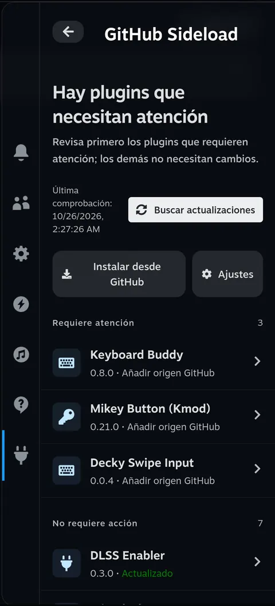
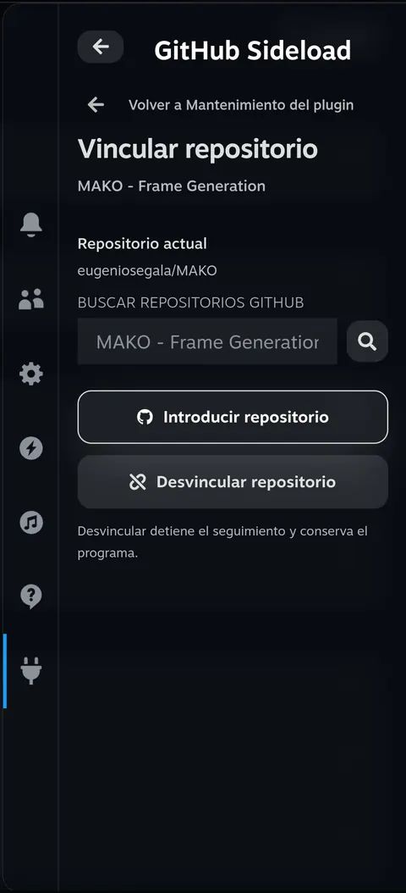
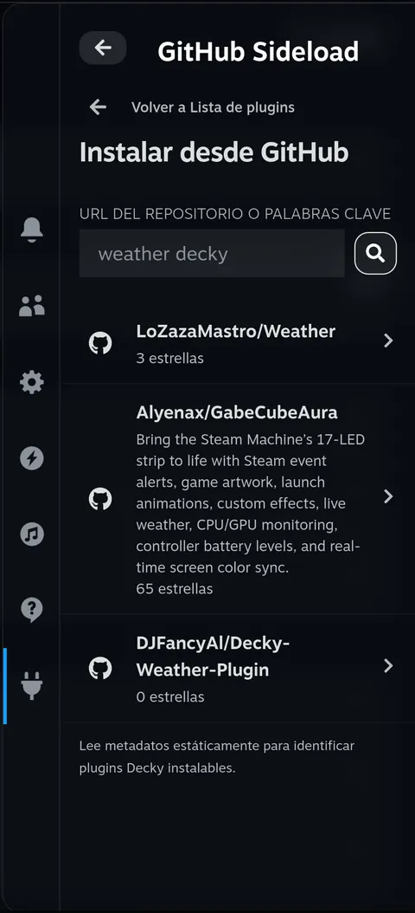
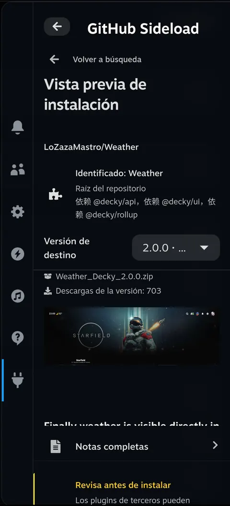
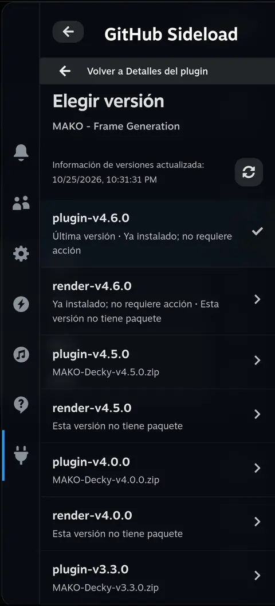
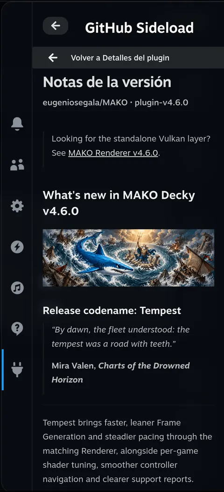
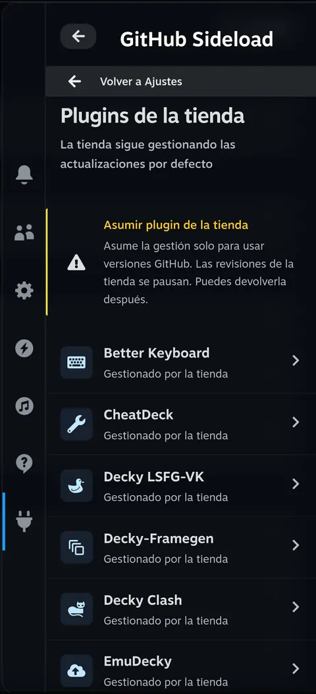
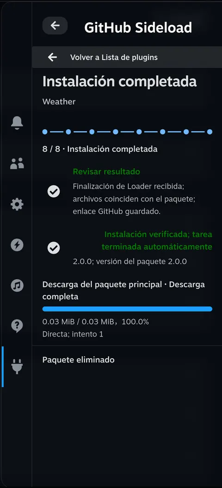
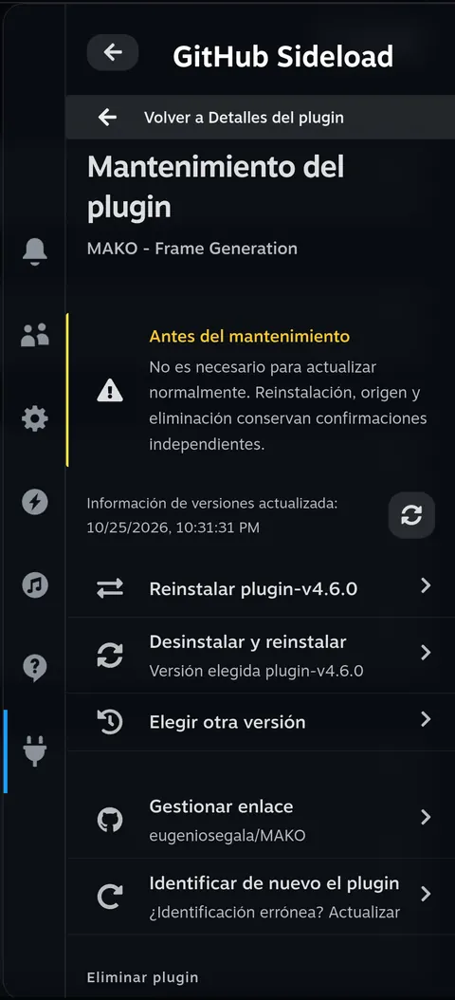

<h1 align="center">decky-sideloader</h1>

decky-sideloader es un plugin de Decky para Steam Deck. Vincula los plugins instalados con sus repositorios de GitHub, busca versiones y permite instalar, actualizar, volver a una versión anterior o reinstalar mediante las confirmaciones del propio Decky. Busca un plugin nuevo o pega la dirección de su repositorio y elige la versión y el paquete desde el menú de acceso rápido (QAM).

<p align="center">
  <a href="../../README.md">English</a> · <a href="./README.zh-CN.md">简体中文</a> · <a href="./README.pt.md">Português</a> · <a href="./README.es.md">Español</a> · <a href="./README.ja.md">日本語</a> · <a href="./README.ko.md">한국어</a>
</p>
<p align="center">
  <a href="#what">Qué puedes hacer</a> · <a href="#why">Por qué creamos decky-sideloader</a> · <a href="#install">Instalación</a> · <a href="#try-it">Primer uso</a> · <a href="#limits">Instalación y copias de seguridad</a> · <a href="#usage">Uso y ajustes</a> · <a href="#language">Idioma</a> · <a href="#development">Información para desarrolladores</a> · <a href="../../CHANGELOG.md">Historial de cambios</a>
</p>

<p align="center">
  <a href="../../assets/readme/es/home.webp"></a>
</p>

<h2 id="what">Qué puedes hacer</h2>

**Reunir tus plugins de GitHub.**

Consulta las versiones instaladas y los resultados de las comprobaciones en una sola lista. Si falta un repositorio, búscalo en GitHub o introduce su dirección. Comprueba las actualizaciones manualmente o activa las comprobaciones periódicas y las notificaciones en Ajustes. Las comprobaciones no instalan actualizaciones automáticamente.

<details>
<summary>Capturas de pantalla</summary>

<p align="center">
  <a href="../../assets/readme/es/binding.webp"></a>
</p>
</details>

**Encontrar e instalar un plugin nuevo.**

Busca plugins con una URL de GitHub, `owner/repo` o palabras clave. Se comprueba que el repositorio contiene archivos de un plugin de Decky; si hay varios plugins, elige el proyecto que quieres.

<details>
<summary>Capturas de pantalla</summary>

<table>
  <tr>
    <td align="center"><a href="../../assets/readme/es/search.webp"></a></td>
    <td align="center"><a href="../../assets/readme/es/preview.webp"></a></td>
  </tr>
</table>
</details>

**Elegir la versión que necesitas.**

Lee las notas, abre el documento Markdown completo, elige otra versión u omite una publicación.

<details>
<summary>Capturas de pantalla</summary>

<table>
  <tr>
    <td align="center"><a href="../../assets/readme/es/versions.webp"></a></td>
    <td align="center"><a href="../../assets/readme/es/release-notes.webp"></a></td>
  </tr>
</table>
</details>

**Separar la gestión de la tienda.**

Los plugins de la tienda siguen bajo su gestión por defecto. Puedes transferirla expresamente a decky-sideloader para usar versiones de GitHub y devolverla después a la tienda.

<details>
<summary>Capturas de pantalla</summary>

<p align="center">
  <a href="../../assets/readme/es/store.webp"></a>
</p>
</details>

**Seguir la instalación.**

Sigue la descarga principal, las dependencias adicionales, la preparación, la confirmación nativa y la verificación en la tarea. Puedes cerrar y reabrir QAM para seguir la misma tarea. Las tareas correctas terminan automáticamente cuando Loader finaliza y se verifican los archivos instalados.

<details>
<summary>Capturas de pantalla</summary>

<table>
  <tr>
    <td align="center"><a href="../../assets/readme/es/task.webp"></a></td>
    <td align="center"><a href="../../assets/readme/es/maintenance.webp"></a></td>
  </tr>
</table>
</details>

<h2 id="why">Por qué creamos decky-sideloader</h2>

Instalar un plugin de Decky desde GitHub implicaba pasar al modo Escritorio para descargar un ZIP, volver al modo Juego, encontrar ese ZIP en Decky Loader y esperar a que terminara la instalación. Era un proceso largo, con cambios de modo solo para instalar un plugin.

Las actualizaciones también pasaban desapercibidas. Muchas veces no sabíamos que un plugin se había actualizado hasta que alguien lo mencionaba en un vídeo o en un chat de grupo. Si la nueva versión no funcionaba bien, volver a una anterior o elegir otra tampoco era sencillo.

<h2 id="install">Instalación</h2>

### Instala Decky primero

Si aún no tienes Decky, sigue las [instrucciones oficiales de instalación de Decky Loader](https://github.com/SteamDeckHomebrew/decky-loader#installation).

### Consigue un paquete de instalación

Crea el ZIP de instalación siguiendo [Compilar desde el código fuente](#build). El resultado está en el directorio `dist/` del repositorio: `dist/decky-sideloader-<version>.zip`.

Copia ese ZIP al Steam Deck y sigue los pasos de abajo. El archivo **Source code (zip)** de GitHub contiene código fuente, no un plugin listo para instalar.

### Instálalo en Decky

Los siguientes nombres corresponden a la interfaz de Decky en inglés:

1. Abre el menú de acceso rápido y selecciona el icono del enchufe. Si tienes abierto otro plugin, vuelve a la lista de plugins de Decky.
2. Selecciona el engranaje para abrir **Decky Settings**.
3. En **General**, activa **Developer mode**.
4. Abre **Developer**. En **Third-Party Plugins**, selecciona **Browse** junto a **Install Plugin from ZIP File**.
5. Lee la confirmación de Decky y selecciona el ZIP preparado.
6. Vuelve a la lista de plugins y abre **Sideloader**.

Para actualizar el propio Sideloader, instala un ZIP más reciente mediante el mismo proceso de Decky. Para eliminarlo, usa **Plugins** en los ajustes de Decky.

<h2 id="try-it">Primer uso</h2>

Abre **Sideloader** en QAM y elige la ruta que corresponda.

### Actualizar un plugin instalado

1. Abre el plugin desde Inicio. Los nombres incluidos en el mapa de repositorios se vinculan automáticamente. Si el enlace falta o es incorrecto, usa **Gestionar enlace**, busca o pega una dirección y selecciona **Guardar vínculo**.
2. Selecciona **Buscar actualizaciones** en Inicio o **Recargar versiones** en los detalles del plugin.
3. Lee las notas, elige la versión que quieres e inicia su instalación.

### Instalar un plugin nuevo

1. Selecciona **Instalar desde GitHub** en Inicio.
2. Introduce una URL de GitHub, `owner/repo` o palabras clave. Elige el repositorio y, si hace falta, el proyecto que contiene.
3. En la vista previa, elige la versión y el ZIP y selecciona **Continuar instalación**.

### Confirmar y seguir la instalación

Sigue las indicaciones para iniciar la preparación. Si el paquete presenta advertencias, revísalas en el diálogo antes de continuar; después confirma la instalación en la ventana nativa de Decky. La tarea muestra el progreso y el resultado; al finalizar, vuelve a la lista de plugins.

Usa **A** para activar un elemento y **B** para volver. Los borradores, versiones elegidas y estado de la tarea se conservan al cerrar y reabrir QAM.

<h2 id="limits">Instalación y copias de seguridad</h2>

### Antes de instalar

- La vista previa muestra el aviso sobre código de terceros y su origen. Si el proyecto declara `root`, también muestra **«Este plugin tiene acceso completo a tu Steam Deck.»** El aviso no aparece en los detalles de plugins ya instalados.
- Hace falta un ZIP preparado para instalar. Una publicación sin paquete sigue visible, pero la vista previa no elige una versión anterior automáticamente. Si el repositorio contiene varios plugins, elige el proyecto; el ZIP descargado se comprueba con respecto a ese proyecto.

### Cancelar y desinstalar primero

- Puedes cancelar mientras la preparación aún pueda detenerse. Una instalación iniciada por Loader no puede interrumpirse aquí. Los resultados fallidos o desconocidos no cuentan como instalaciones completadas.
- **Desinstalar y reinstalar** prepara el paquete y la copia antes de pedir permiso para desinstalar. La confirmación de Decky sigue a la verificación de la eliminación. La rutina de desinstalación del propio plugin puede modificar sus datos.

### Qué se copia y dónde se guarda

Antes de sustituir un plugin, se copian sus directorios estándar de Decky `settings/<folder>` y `data/<folder>`. No se incluyen rutas personalizadas ni hay restauración o reversión automática.

La tarea muestra qué datos se copiaron y dónde se guardó la copia. La ubicación habitual es:

```text
~/homebrew/data/decky-sideloader/installations/<operation-id>/data-backup.zip
```

### Conservación y limpieza

- Las copias de más de siete días se eliminan al iniciar el plugin, cada hora y antes de preparar una instalación.
- **Ajustes → Eliminar copias de seguridad** también elimina copias recientes tras confirmar. Las tareas activas o con resultado desconocido conservan sus copias.
- La limpieza solo elimina las copias, no los datos originales ni los paquetes de instalación. Eliminar el paquete tras instalar es una opción independiente.

<details>
<summary>Límites de paquetes y almacenamiento</summary>

| Elemento | Límite |
| --- | --- |
| ZIP principal del plugin | 128 MiB |
| Contenido descomprimido | 512 MiB y 10.000 archivos |
| Cada copia de datos | 512 MiB y 10.000 archivos |
| Datos de tareas existentes | Por encima de 768 MiB, no se puede iniciar una tarea nueva |

</details>

<h2 id="usage">Uso y ajustes</h2>

### Elegir versiones

Los detalles conservan la última lista obtenida correctamente hasta que la recargas o buscas actualizaciones. Se mantiene la selección si sigue siendo válida; usa **Elegir otra versión** para cambiar a una versión recién encontrada.

### Mantenimiento y gestión de la tienda

Abre **Mantenimiento del plugin** en los detalles para reinstalar la misma versión, desinstalar y reinstalar, cambiar el enlace o eliminar el plugin. Las actualizaciones normales usan las acciones de versión en los detalles.

Para usar una versión GitHub de un plugin de la tienda, abre **Ajustes → Plugins de la tienda** y asume expresamente su gestión. Esto pausa sus comprobaciones nativas de la tienda. **Devolver a la tienda** restaura la configuración de actualizaciones anterior.

### Mapa de repositorios

Abre **Ajustes → Mapa de repositorios → Actualizar mapa** para descargar la versión más reciente sin actualizar Sideloader. Al abrir el plugin solo se usan datos locales, sin descargar el mapa. Se usa la revisión válida más reciente entre el mapa incluido y el descargado; si la actualización falla, se conserva el actual. Se mantienen los enlaces manuales, los repositorios confirmados por instalaciones completadas o por la gestión de la tienda y las decisiones de detener el seguimiento. Finaliza las instalaciones y comprobaciones de versiones antes de actualizar el mapa.

La fuente mantenida es [`data/repositories.json`](../../data/repositories.json). Las claves coinciden exactamente con el `plugin.json.name` del proyecto, incluidos los proyectos de un monorepo; los valores usan `owner/repo` de GitHub. Verifica el manifiesto antes de añadir una entrada, incrementa `revision`, actualiza `updated_at` y ejecuta `python3 -B scripts/check-repository-map.py`. CI también compara la revisión con el commit base. El paquete incluye la instantánea revisada de su commit, sin descargar datos durante la compilación. Un enlace no asume la gestión de un plugin de la tienda.

<details>
<summary>Ajustes de conexión</summary>

Abre **Ajustes → Conexión de red**. La conexión directa es la predeterminada.

- **Solo conexión directa:** conecta directamente con GitHub.
- **Alternativa automática:** prueba la conexión directa, GH-Proxy y luego GHFast para los archivos compatibles.
- **Solo GH-Proxy:** usa GH-Proxy.
- **GHFast (archivos):** acelera los archivos compatibles; la API de GitHub usa conexión directa con GH-Proxy como alternativa.

Los modos de terceros muestran la dirección y requieren consentimiento antes de guardar. No cambian el proxy del sistema; una tarea activa mantiene su modo inicial. Si GitHub limita las solicitudes, respeta la hora de reintento del error.

</details>

<details>
<summary>Compartir registros de diagnóstico</summary>

**Cómo descargar**

Abre **Ajustes → Comentarios / registros** y selecciona **Generar QR de descarga**. Descarga el ZIP con un teléfono u ordenador en la misma red local de confianza. La compartición solo empieza al solicitarla; no hay envío automático a un servicio remoto.

**Plazo y conservación**

El enlace usa HTTP sin cifrar y caduca tras cinco minutos o tres transferencias completas. Puedes detenerlo antes.

| Elemento | Límite |
| --- | --- |
| Registros almacenados | 4 MiB |
| Cada paquete de diagnóstico | 6 MiB |
| Paquetes conservados | Los tres últimos |

**Información incluida y excluida**

- Los nombres, repositorios y etiquetas usan identificadores seudónimos.
- Solo al pedir un paquete se recopilan la versión de Steam en ejecución, versión/compilación del sistema, kernel legible, arquitectura de CPU y fabricante/modelo no exclusivos, incluida la identificación de Steam Deck LCD/OLED. Abrir el diagnóstico o actualizar el estado no inicia la recopilación.
- Se excluyen mensajes originales, URL completas, rutas locales, credenciales y archivos del usuario.
- Se excluyen nombres de host, números de serie, UUID, direcciones MAC y cuentas.

**Contenido técnico**

Incluye códigos de error y ubicaciones de código seguros, eventos RPC/red/tarea correlacionados, progreso separado de dependencias, datos de gestión/bloqueo y limpieza, opciones operativas y huellas independientes de frontend/backend. La exportación lee el estado existente sin actualizar repositorios ni continuar tareas.

</details>

<h2 id="language">Idioma</h2>

La interfaz sigue el idioma de Steam hasta que eliges otro. **Language / 语言** aparece al final de la página principal y de Ajustes y ofrece chino simplificado, inglés, portugués, español, japonés y coreano.

La elección manual se guarda para este plugin. Cambiar de idioma conserva la página, los campos introducidos, la versión seleccionada y la tarea. Las notas de versiones de GitHub y los documentos de licencia de terceros mantienen sus idiomas originales.

Este README está disponible en los mismos seis idiomas mediante los enlaces de la parte superior.

<h2 id="development">Información para desarrolladores</h2>

<details id="build">
<summary>Compilar desde el código fuente</summary>

Necesitas Node.js, pnpm, Bun y Python 3. Ejecuta estos comandos desde la raíz del repositorio:

```sh
pnpm install --frozen-lockfile
pnpm typecheck
pnpm test
pnpm test:python
pnpm build
```

Después de compilar, crea el ZIP de instalación:

```sh
pnpm package-plugin
```

El ZIP incluye la interfaz, el backend de Python, los avisos de licencia y los seis README. No añadas ajustes del dispositivo, registros ni copias de seguridad.

El resultado es `dist/decky-sideloader-<version>.zip`. El código del backend está en `backend/main.py` y en los módulos por función de `backend/sideload/`; el empaquetado los coloca en `main.py` y `py_modules/sideload/`, como requiere Loader. No copies directamente la estructura del código fuente al dispositivo.

El workflow de GitHub en `.github/workflows/build.yml` valida y compila las pull requests y los envíos a `main`, y sube el ZIP de instalación como artefacto. Al enviar una etiqueta `v<version>` que coincida con `package.json`, también publica una GitHub Release con el ZIP y la sección completa en inglés y chino de esa versión de `CHANGELOG.md`.

</details>

## Licencia

[BSD 3-Clause](../../LICENSE). Copyright (c) 2026, zacharym. Derechos del modelo original: Copyright (c) 2022–2024, Steam Deck Homebrew.

Los componentes de terceros conservan sus propias licencias. Consulta los avisos incluidos en **Ajustes → Licencias de código abierto**.
