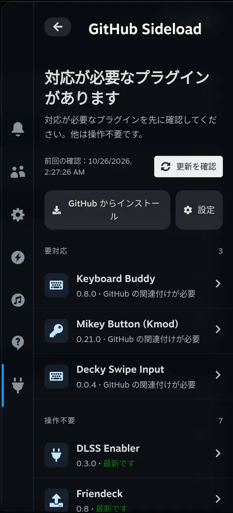
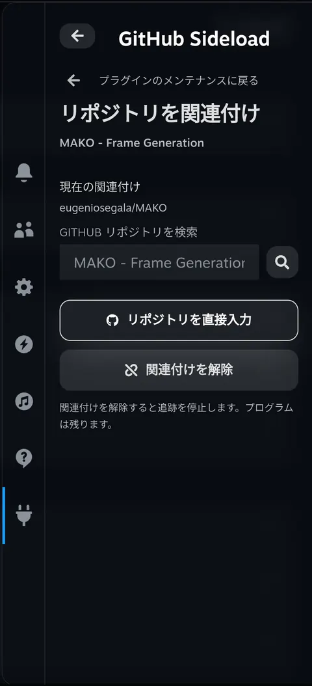
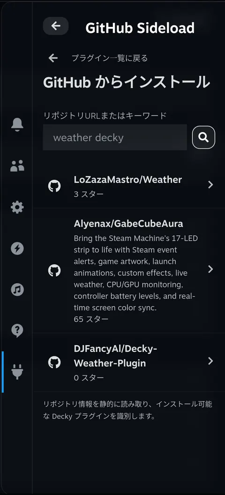
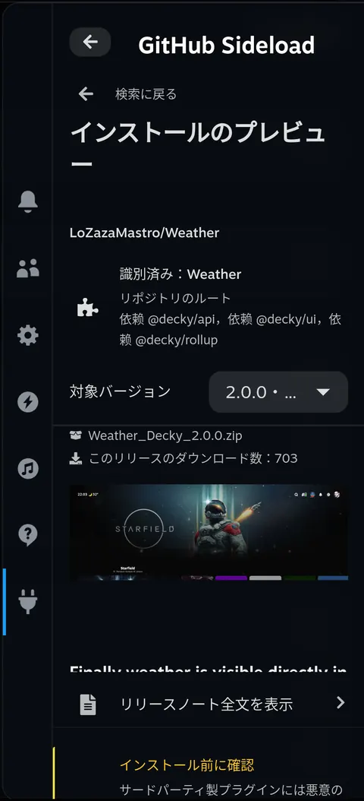
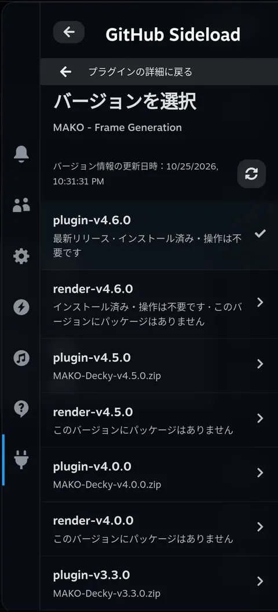
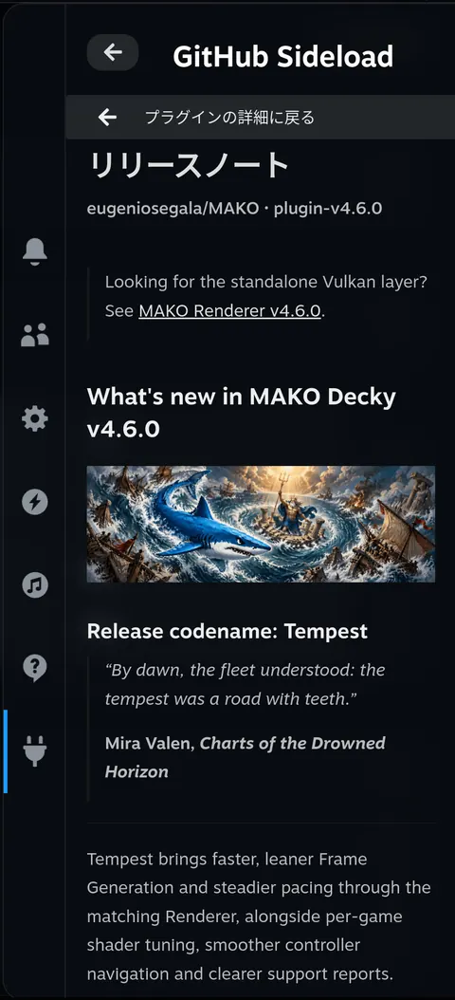
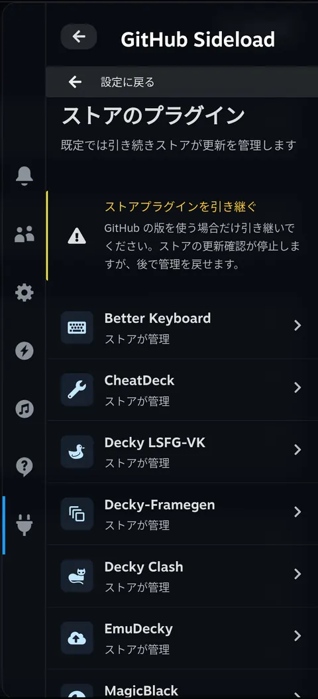
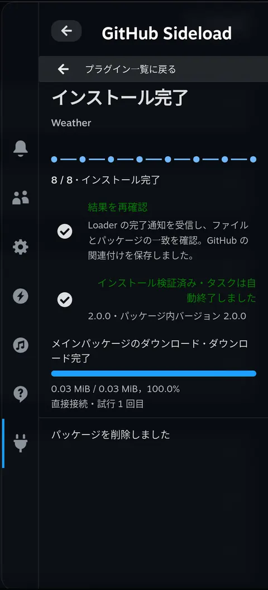
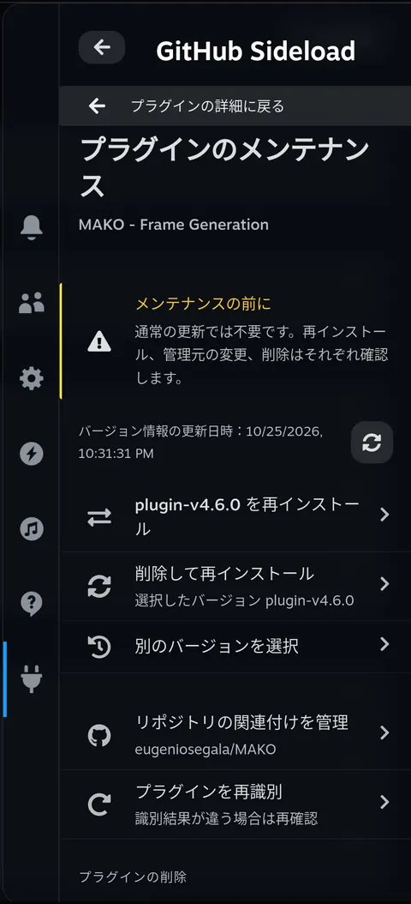

<h1 align="center">decky-sideloader</h1>

decky-sideloader は Steam Deck 向けの Decky プラグインです。インストール済みプラグインを GitHub リポジトリに関連付け、リリースを確認し、Decky 自身の確認画面からインストール、更新、ダウングレード、再インストールを行えます。クイックアクセスメニュー（QAM）でプラグインを検索するかリポジトリのアドレスを貼り付け、リリースとインストールパッケージを選びます。

<p align="center">
  <a href="../../README.md">English</a> · <a href="./README.zh-CN.md">简体中文</a> · <a href="./README.pt.md">Português</a> · <a href="./README.es.md">Español</a> · <a href="./README.ja.md">日本語</a> · <a href="./README.ko.md">한국어</a>
</p>
<p align="center">
  <a href="#what">できること</a> · <a href="#why">decky-sideloader を作った理由</a> · <a href="#install">インストール</a> · <a href="#try-it">使い始める</a> · <a href="#limits">インストールとバックアップ</a> · <a href="#usage">使い方と設定</a> · <a href="#language">言語</a> · <a href="#development">開発者向け情報</a> · <a href="../../CHANGELOG.md">変更履歴</a>
</p>

<p align="center">
  <a href="../../assets/readme/ja/home.webp"></a>
</p>

<h2 id="what">できること</h2>

**GitHub のプラグインをまとめて管理。**

インストール済みバージョンと更新確認の結果を、ひとつの一覧で確認できます。リポジトリが未設定なら、GitHub で検索するかアドレスを入力して関連付けます。手動で更新を確認するほか、設定から定期確認と通知を有効にできます。更新確認だけで自動インストールされることはありません。

<details>
<summary>スクリーンショット</summary>

<p align="center">
  <a href="../../assets/readme/ja/binding.webp"></a>
</p>
</details>

**新しいプラグインを探してインストール。**

GitHub の URL、`owner/repo`、キーワードでプラグインを探せます。リポジトリ内の Decky プラグイン用ファイルを確認し、複数のプラグインがある場合は目的のプロジェクトを選択できます。

<details>
<summary>スクリーンショット</summary>

<table>
  <tr>
    <td align="center"><a href="../../assets/readme/ja/search.webp"></a></td>
    <td align="center"><a href="../../assets/readme/ja/preview.webp"></a></td>
  </tr>
</table>
</details>

**使いたいリリースを選択。**

リリースノートや Markdown の全文を読み、別のバージョンを選んだり、特定のリリースをスキップしたりできます。

<details>
<summary>スクリーンショット</summary>

<table>
  <tr>
    <td align="center"><a href="../../assets/readme/ja/versions.webp"></a></td>
    <td align="center"><a href="../../assets/readme/ja/release-notes.webp"></a></td>
  </tr>
</table>
</details>

**ストアによる管理と分離。**

ストア管理のプラグインは、既定では引き続きストアが管理します。GitHub のリリースを使うために管理を明示的に引き継ぎ、後からストアへ戻すこともできます。

<details>
<summary>スクリーンショット</summary>

<p align="center">
  <a href="../../assets/readme/ja/store.webp"></a>
</p>
</details>

**インストールの進行状況を確認。**

タスク画面で本体と追加依存ファイルのダウンロード、準備、ネイティブ確認、検証を追えます。QAM を閉じても同じタスクを開き直せます。Loader の完了とインストール済みファイルの検証がそろうと、成功したタスクは自動的に終了します。

<details>
<summary>スクリーンショット</summary>

<table>
  <tr>
    <td align="center"><a href="../../assets/readme/ja/task.webp"></a></td>
    <td align="center"><a href="../../assets/readme/ja/maintenance.webp"></a></td>
  </tr>
</table>
</details>

<h2 id="why">decky-sideloader を作った理由</h2>

GitHub の Decky プラグインをインストールするには、まずデスクトップモードで ZIP をダウンロードし、ゲームモードに戻って Decky Loader からその ZIP を探し、インストールが終わるのを待つ必要がありました。手順が長く、プラグインをひとつ入れるだけでもモードの切り替えが必要でした。

GitHub 上でプラグインが更新されても気づきにくく、動画サイトやグループチャットで誰かが話題にして初めて知ることもよくありました。新しいバージョンで問題があっても、以前のバージョンに戻したり、別のバージョンに切り替えたりするのは簡単ではありませんでした。

<h2 id="install">インストール</h2>

### 先に Decky をインストール

Decky がまだない場合は、公式の [Decky Loader インストール手順](https://github.com/SteamDeckHomebrew/decky-loader#installation)に従ってください。

### インストールパッケージを用意

[ソースからビルド](#build)してインストール ZIP を作成します。出力先はリポジトリの `dist/` ディレクトリ内の `dist/decky-sideloader-<version>.zip` です。

この ZIP を Steam Deck にコピーし、以下の手順でインストールします。GitHub の **Source code (zip)** はソースコードであり、そのままインストールできるプラグインではありません。

### Decky からインストール

以下は Decky の英語表示でのメニュー名です。

1. クイックアクセスメニューを開き、プラグのアイコンを選びます。別のプラグインが開いている場合は、Decky のプラグイン一覧に戻ります。
2. 歯車を選び、**Decky Settings** を開きます。
3. **General** で **Developer mode** を有効にします。
4. **Developer** を開き、**Third-Party Plugins** の **Install Plugin from ZIP File** にある **Browse** を選びます。
5. Decky の確認内容を読み、パッケージ化された ZIP を選びます。
6. プラグイン一覧に戻り、**Sideloader** を開きます。

Sideloader 自体を更新する場合も、同じ Decky の手順で新しい ZIP をインストールします。削除する場合は、Decky 設定の **Plugins** を使用します。

<h2 id="try-it">使い始める</h2>

QAM で **Sideloader** を開き、目的に合う手順を選びます。

### インストール済みプラグインを更新

1. ホームから対象を開きます。リポジトリが未設定なら「リポジトリの関連付けを管理」で検索またはアドレスを入力し、「関連付けを保存」を選びます。
2. ホームの「更新を確認」、または詳細画面の「バージョンを再読み込み」を選びます。
3. リリースノートを読み、使いたいバージョンを選択してインストールを開始します。

### 新しいプラグインをインストール

1. ホームで「GitHub からインストール」を選びます。
2. GitHub の URL、`owner/repo`、キーワードを入力してリポジトリを選びます。必要に応じてプロジェクトも選択します。
3. プレビューでリリースと ZIP を選び、「インストールを続行」を選択します。

### インストールを確認して進行状況を見る

画面の案内に従って準備を開始します。準備後に Decky のネイティブ画面でインストールを確定します。タスク画面で進行状況と結果を確認し、完了後にプラグイン一覧へ戻ります。

**A** で項目を実行し、**B** で戻ります。検索中の入力、バージョン選択、タスク状態は QAM を開き直しても保持されます。

<h2 id="limits">インストールとバックアップ</h2>

### インストール前の確認

- 新規プレビューには第三者のコードと配布元に関する警告が表示されます。プロジェクトが `root` を宣言する場合は、**「このプラグインは Steam Deck に完全にアクセスできます。」** とも表示されます。インストール済みプラグインの詳細には表示されません。
- インストール用のプラグイン ZIP が必要です。パッケージのないリリースも表示しますが、自動的に古いリリースへ切り替えません。複数のプラグインがある場合は対象を選びます。ダウンロードした ZIP は選択したプロジェクトと照合します。

### キャンセルと削除後の再インストール

- 準備を停止できる段階ではキャンセルできます。Loader が開始したインストールは、ここから中断できません。失敗や結果不明を完了として扱いません。
- 「削除して再インストール」は先にパッケージとバックアップを準備し、その後に削除の許可を求めます。削除を確認してから Decky のインストール確認に進みます。対象自身のアンインストール処理がデータを変更する場合があります。

### バックアップの対象と保存先

既存プラグインの置き換え前に Decky 標準の `settings/<folder>` と `data/<folder>` をバックアップします。独自の保存先は含まず、自動復元やロールバックは行いません。

タスク画面で対象データと実際の保存先を確認できます。通常の保存先は次のとおりです。

```text
~/homebrew/data/decky-sideloader/installations/<operation-id>/data-backup.zip
```

### 保持と削除

- 7 日を超えたバックアップは、起動時、1 時間ごと、新しいインストールの準備前に削除されます。
- 「設定 → データバックアップを削除」では確認後に最近のバックアップも削除できます。実行中または結果不明のタスクのバックアップは保持します。
- 削除するのはバックアップのアーカイブのみで、元のデータやインストールパッケージは変更しません。インストール後のパッケージ削除は別設定です。

<details>
<summary>パッケージと保存容量の上限</summary>

| 対象 | 上限 |
| --- | --- |
| プラグイン本体の ZIP | 128 MiB |
| パッケージの展開内容 | 512 MiB、10,000 ファイル |
| 個々のデータバックアップ | 512 MiB、10,000 ファイル |
| 既存のタスクデータ | 768 MiB を超えると新しいタスクを開始できません |

</details>

<h2 id="usage">使い方と設定</h2>

### バージョンの選択

詳細画面は再読み込みまたは更新確認まで、最後に取得できた一覧を保持します。更新後も有効な選択は維持します。新しいリリースへ切り替えるには「別のバージョンを選択」を使います。

### メンテナンスとストア管理

詳細の「プラグインのメンテナンス」から同版の再インストール、削除して再インストール、関連付け変更、削除を行えます。通常の更新は詳細のバージョン操作を使います。

ストアのプラグインで GitHub リリースを使う場合は「設定 → ストアのプラグイン」で管理を明示的に引き継ぎます。ストアの更新確認が停止され、「ストアに管理を戻す」で以前の更新設定へ戻せます。

<details>
<summary>接続設定</summary>

「設定 → ネットワーク接続」を開きます。既定は直接接続です。

- **直接接続のみ**：GitHub に直接接続します。
- **自動フォールバック**：直接接続、GH-Proxy、対応ファイルでは GHFast の順に試します。
- **GH-Proxy のみ**：GH-Proxy を使います。
- **GHFast（ファイル）**：対応ファイルを高速化します。GitHub API は直接接続し、必要に応じて GH-Proxy を使います。

第三者サービスのモードでは保存前にアドレスを表示し、同意を求めます。システムのプロキシは変更せず、実行中のタスクは元のモードを維持します。レート制限時はエラーに示された時刻以降に再試行してください。

</details>

<details>
<summary>診断ログを共有</summary>

**ダウンロード方法**

「設定 → 問題の報告・診断ログ」で「ダウンロード用 QR コードを生成」を選びます。同じ信頼できるローカルネットワークの端末で ZIP を取得します。共有は要求時のみ開始し、ログを外部へ自動送信しません。

**共有期限と保持**

リンクは暗号化されていない HTTP を使い、5 分または 3 回の完全な転送で失効します。手動で停止することもできます。

| 対象 | 上限 |
| --- | --- |
| 保存ログ | 4 MiB |
| 個々の診断パッケージ | 6 MiB |
| 保持パッケージ | 最新 3 件 |

**含む情報・含まない情報**

- 名前、リポジトリ、リリースタグは仮名化した識別子を使います。
- 生成を要求したときだけ、実行中の Steam クライアントのバージョン、OS のバージョン・ビルド、読めるカーネルバージョン、CPU アーキテクチャ、固有識別子ではない製造元・機種情報と Steam Deck LCD/OLED の識別を取得します。診断ページや状態更新だけでは取得しません。
- 元のエラー文、完全な URL、ローカルパス、認証情報、ユーザーファイルは含みません。
- ホスト名、シリアル番号、UUID、MAC アドレス、アカウント情報は含みません。

**技術的な内容**

安全なエラーコードとソース位置、関連付けられた RPC・通信・タスクのイベント、依存ファイルの個別進捗、管理状態・更新凍結・削除結果、動作設定、フロントエンド／バックエンドの独立したビルド識別情報を含みます。既存の状態を読むだけで、リポジトリ更新やタスク続行は行いません。

</details>

<h2 id="language">言語</h2>

手動で選ぶまでは Steam の表示言語に従います。ホームと設定の下部にある **Language / 语言** から、簡体字中国語、英語、ポルトガル語、スペイン語、日本語、韓国語を選べます。

手動の選択は、このプラグイン用に保存されます。言語を変えても、ページ、入力、選択したバージョン、タスクは維持されます。GitHub のリリースノートと第三者のライセンス文書は原文のままです。

この README も同じ 6 言語に対応しており、上部のリンクから切り替えられます。

<h2 id="development">開発者向け情報</h2>

<details id="build">
<summary>ソースからビルド</summary>

Node.js、pnpm、Bun、Python 3 が必要です。リポジトリのルートで次を実行します。

```sh
pnpm install --frozen-lockfile
pnpm typecheck
pnpm test
pnpm test:python
pnpm build
```

ビルド後、インストール ZIP を作成します。

```sh
pnpm package-plugin
```

ZIP にはフロントエンド、Python バックエンド、ライセンス情報、6 言語の README が含まれます。デバイスの設定、ログ、バックアップは追加しないでください。

出力先は `dist/decky-sideloader-<version>.zip` です。バックエンドのソースは `backend/main.py` と機能別の `backend/sideload/` にあり、パッケージ化時に Loader が必要とする `main.py` と `py_modules/sideload/` へ配置します。ソースのディレクトリ構成をそのままデバイスへコピーしないでください。

`.github/workflows/build.yml` の GitHub workflow は Pull Request と `main` へのプッシュを検証・ビルドし、インストール ZIP をアーティファクトとして保存します。`package.json` のバージョンと一致する `v<version>` タグをプッシュすると、ZIP と `CHANGELOG.md` の該当バージョンの英語・中国語の全文を含む GitHub Release も公開します。

</details>

## ライセンス

[BSD 3-Clause](../../LICENSE)。Copyright (c) 2026, zacharym。元テンプレートの著作権：Copyright (c) 2022–2024, Steam Deck Homebrew。

第三者コンポーネントには、それぞれのライセンスが適用されます。同梱のライセンス情報は「設定 → オープンソースライセンス」で確認できます。
