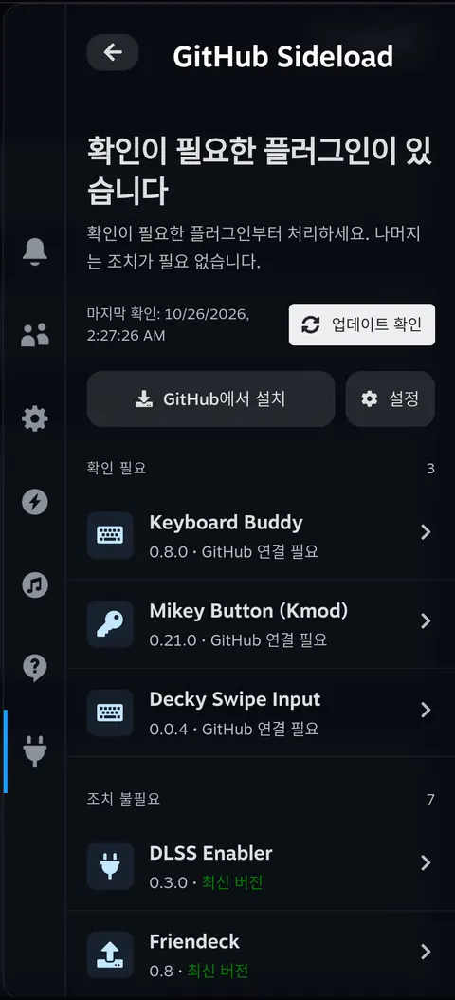
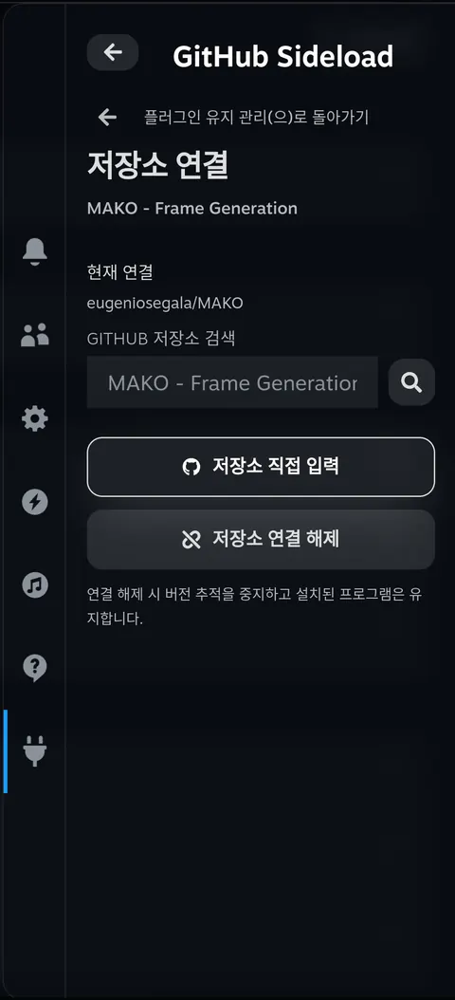
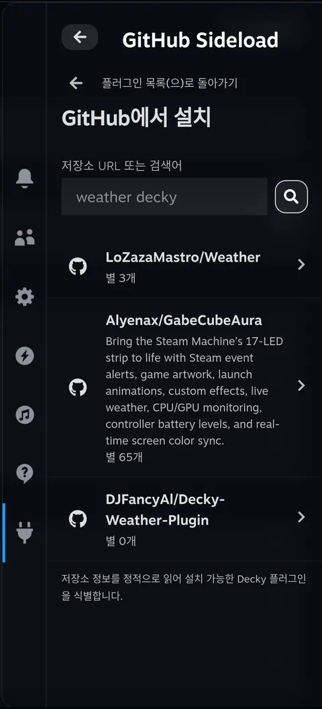
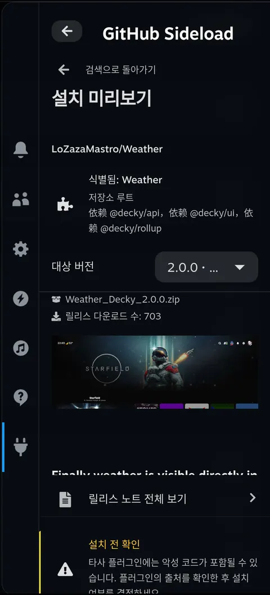
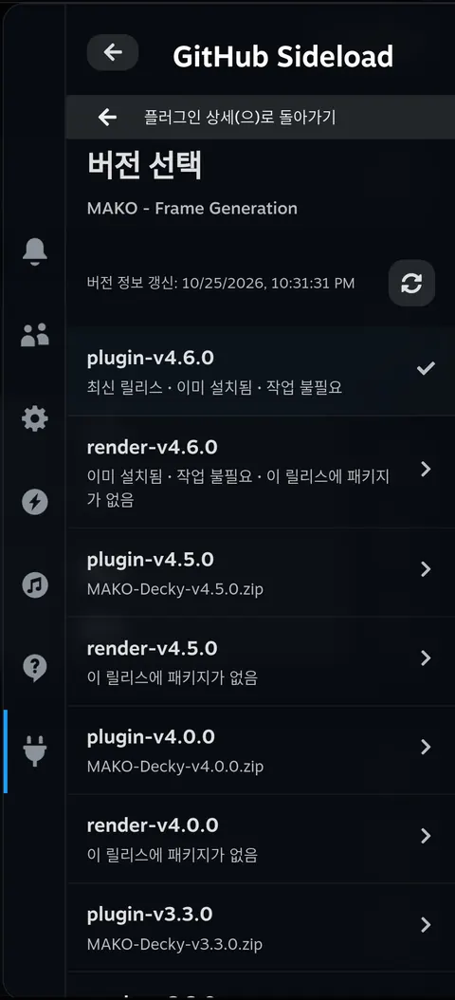
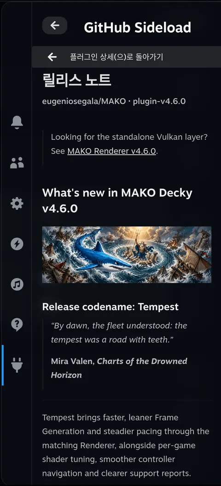
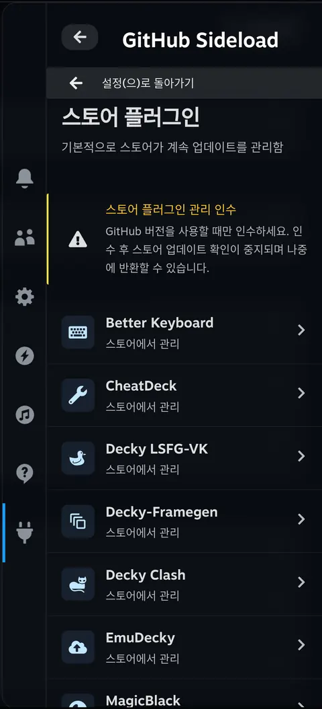
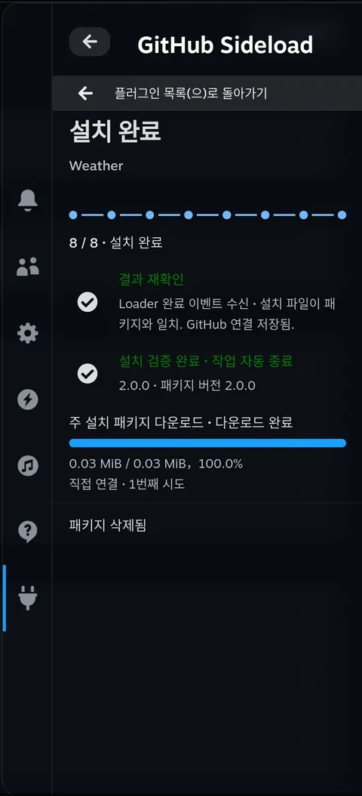
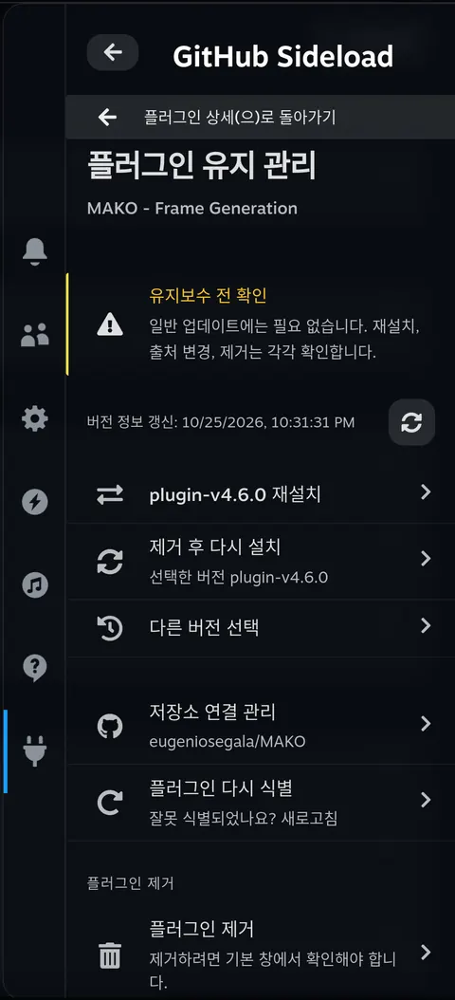

<h1 align="center">decky-sideloader</h1>

decky-sideloader는 Steam Deck용 Decky 플러그인입니다. 설치된 플러그인을 GitHub 저장소에 연결하고 릴리스를 확인하며, Decky 자체 확인 창을 통해 설치, 업데이트, 이전 버전 설치, 재설치를 진행합니다. 빠른 설정 메뉴(QAM)에서 새 플러그인을 검색하거나 저장소 주소를 붙여 넣은 뒤 릴리스와 설치 패키지를 선택할 수 있습니다.

<p align="center">
  <a href="../../README.md">English</a> · <a href="./README.zh-CN.md">简体中文</a> · <a href="./README.pt.md">Português</a> · <a href="./README.es.md">Español</a> · <a href="./README.ja.md">日本語</a> · <a href="./README.ko.md">한국어</a>
</p>
<p align="center">
  <a href="#what">주요 기능</a> · <a href="#why">decky-sideloader를 만든 이유</a> · <a href="#install">설치</a> · <a href="#try-it">처음 사용하기</a> · <a href="#limits">설치와 백업</a> · <a href="#usage">사용 방법과 설정</a> · <a href="#language">언어</a> · <a href="#development">개발자 정보</a> · <a href="../../CHANGELOG.md">변경 기록</a>
</p>

<p align="center">
  <a href="../../assets/readme/ko/home.webp"></a>
</p>

<h2 id="what">주요 기능</h2>

**GitHub 플러그인을 한곳에서 관리합니다.**

설치된 버전과 업데이트 확인 결과를 하나의 목록에서 볼 수 있습니다. 저장소 연결이 없으면 GitHub를 검색하거나 주소를 입력해 연결합니다. 수동으로 업데이트를 확인하거나 설정에서 정기 확인과 알림을 켤 수 있습니다. 업데이트 확인만으로 자동 설치되지는 않습니다.

<details>
<summary>스크린샷</summary>

<p align="center">
  <a href="../../assets/readme/ko/binding.webp"></a>
</p>
</details>

**새 플러그인을 찾아 설치합니다.**

GitHub URL, `owner/repo`, 검색어로 플러그인을 찾습니다. 저장소의 Decky 플러그인 파일을 확인하며, 여러 플러그인이 있으면 원하는 프로젝트를 선택할 수 있습니다.

<details>
<summary>스크린샷</summary>

<table>
  <tr>
    <td align="center"><a href="../../assets/readme/ko/search.webp"></a></td>
    <td align="center"><a href="../../assets/readme/ko/preview.webp"></a></td>
  </tr>
</table>
</details>

**원하는 릴리스를 선택합니다.**

릴리스 노트와 전체 Markdown 문서를 읽고 다른 버전을 선택하거나 특정 릴리스를 건너뛸 수 있습니다.

<details>
<summary>스크린샷</summary>

<table>
  <tr>
    <td align="center"><a href="../../assets/readme/ko/versions.webp"></a></td>
    <td align="center"><a href="../../assets/readme/ko/release-notes.webp"></a></td>
  </tr>
</table>
</details>

**스토어 관리를 별도로 유지합니다.**

스토어 플러그인은 기본적으로 스토어가 계속 관리합니다. GitHub 버전을 사용하려면 관리를 명시적으로 넘길 수 있으며, 나중에 스토어로 돌려줄 수도 있습니다.

<details>
<summary>스크린샷</summary>

<p align="center">
  <a href="../../assets/readme/ko/store.webp"></a>
</p>
</details>

**설치 진행 상황을 확인합니다.**

작업 화면에서 기본 패키지와 추가 의존 파일 다운로드, 준비, 기본 확인 창, 검증을 확인합니다. QAM을 닫았다가 열어도 같은 작업을 볼 수 있습니다. Loader 완료와 설치 파일 검증이 모두 확인되면 성공한 작업은 자동으로 끝납니다.

<details>
<summary>스크린샷</summary>

<table>
  <tr>
    <td align="center"><a href="../../assets/readme/ko/task.webp"></a></td>
    <td align="center"><a href="../../assets/readme/ko/maintenance.webp"></a></td>
  </tr>
</table>
</details>

<h2 id="why">decky-sideloader를 만든 이유</h2>

GitHub의 Decky 플러그인을 설치하려면 먼저 데스크톱 모드로 전환해 ZIP을 다운로드하고, 게임 모드로 돌아와 Decky Loader에서 그 ZIP을 찾아 설치가 끝날 때까지 기다려야 했습니다. 플러그인 하나를 설치하는 데도 과정이 길고 모드를 오가야 했습니다.

GitHub에서 플러그인이 업데이트되어도 알기 어려웠습니다. 동영상 사이트나 단체 채팅방에서 누군가 이야기한 뒤에야 새 버전이 나왔다는 걸 아는 경우가 많았습니다. 새 버전이 잘 작동하지 않으면 이전 버전으로 돌아가거나 다른 버전으로 바꾸는 것도 번거로웠습니다.

<h2 id="install">설치</h2>

### 먼저 Decky 설치하기

Decky가 없다면 공식 [Decky Loader 설치 안내](https://github.com/SteamDeckHomebrew/decky-loader#installation)를 따라 설치하세요.

### 설치 패키지 준비하기

[소스에서 빌드하기](#build)에 따라 설치 ZIP을 만드세요. 결과물은 저장소의 `dist/` 디렉터리 안에 있는 `dist/decky-sideloader-<version>.zip`입니다.

이 ZIP을 Steam Deck으로 복사한 뒤 아래 절차로 설치하세요. GitHub의 <strong>Source code (zip)</strong>은 소스 코드이며 바로 설치할 수 있는 플러그인 패키지가 아닙니다.

### Decky에서 설치하기

다음 메뉴 이름은 Decky의 영어 인터페이스 기준입니다.

1. 빠른 설정 메뉴를 열고 플러그 아이콘을 선택합니다. 다른 플러그인이 열려 있으면 Decky 플러그인 목록으로 돌아갑니다.
2. 톱니바퀴를 선택해 **Decky Settings**를 엽니다.
3. **General**에서 **Developer mode**를 켭니다.
4. **Developer**를 엽니다. **Third-Party Plugins** 아래 **Install Plugin from ZIP File** 옆의 **Browse**를 선택합니다.
5. Decky의 확인 내용을 읽고 패키징된 ZIP을 선택합니다.
6. 플러그인 목록으로 돌아가 **Sideloader**를 엽니다.

Sideloader 자체를 업데이트할 때도 같은 Decky 절차로 새 ZIP을 설치합니다. 제거하려면 Decky 설정의 **Plugins**를 사용하세요.

<h2 id="try-it">처음 사용하기</h2>

QAM에서 **Sideloader**를 열고 원하는 작업의 절차를 선택하세요.

### 설치된 플러그인 업데이트

1. 홈에서 플러그인을 엽니다. 기본 저장소 매핑에 등록된 이름은 자동으로 연결됩니다. 저장소가 없거나 잘못 연결되었으면 **저장소 연결 관리**에서 검색하거나 주소를 입력한 뒤 **연결 저장**을 선택합니다.
2. 홈의 **업데이트 확인** 또는 상세 화면의 **버전 다시 불러오기**를 선택합니다.
3. 릴리스 노트를 읽고 원하는 버전을 선택해 설치를 시작합니다.

### 새 플러그인 설치

1. 홈에서 **GitHub에서 설치**를 선택합니다.
2. GitHub URL, `owner/repo`, 검색어를 입력해 저장소를 선택합니다. 필요하면 프로젝트도 선택합니다.
3. 미리보기에서 릴리스와 ZIP을 선택하고 **설치 계속**을 누릅니다.

### 설치 확인 및 결과 보기

화면 안내에 따라 준비를 시작합니다. 패키지에 경고가 있으면 확인 창에서 내용을 검토한 뒤 계속하고, Decky 기본 확인 창에서 설치를 확정합니다. 작업 화면에서 진행 상황과 결과를 확인하고 완료 후 플러그인 목록으로 돌아갑니다.

**A**로 항목을 실행하고 **B**로 돌아갑니다. 검색 입력, 버전 선택, 작업 상태는 QAM을 다시 열어도 유지됩니다.

<h2 id="limits">설치와 백업</h2>

### 설치 전 확인

- 새 설치 미리보기에는 제3자 코드와 출처 경고가 표시됩니다. 프로젝트가 `root`를 선언하면 <strong>“이 플러그인은 Steam Deck에 완전히 접근할 수 있습니다.”</strong>도 표시됩니다. 설치된 플러그인 상세에는 표시되지 않습니다.
- 설치용 플러그인 ZIP이 필요합니다. 패키지가 없는 릴리스도 보이지만 자동으로 이전 릴리스를 선택하지는 않습니다. 여러 플러그인이 있으면 프로젝트를 선택하며, 다운로드한 ZIP을 선택한 프로젝트와 대조합니다.

### 취소와 제거 후 재설치

- 준비를 아직 중지할 수 있으면 취소할 수 있습니다. Loader가 시작한 설치는 여기서 중단할 수 없습니다. 실패나 결과 불명을 완료로 처리하지 않습니다.
- **제거 후 다시 설치**는 먼저 패키지와 백업을 준비한 뒤 제거 허가를 요청합니다. 제거를 검증한 후 Decky 설치 확인 창이 열립니다. 대상 플러그인 자체의 제거 처리가 데이터를 변경할 수 있습니다.

### 백업 대상과 저장 위치

기존 플러그인을 교체하기 전에 Decky 표준 `settings/<folder>`와 `data/<folder>`를 백업합니다. 사용자 정의 경로는 포함되지 않으며 자동 복원이나 롤백은 없습니다.

작업 화면에서 백업한 데이터와 실제 저장 위치를 확인할 수 있습니다. 일반적인 위치는 다음과 같습니다.

```text
~/homebrew/data/decky-sideloader/installations/<operation-id>/data-backup.zip
```

### 보관과 정리

- 7일이 지난 백업은 플러그인 시작 시, 매시간, 새 설치 준비 전에 삭제됩니다.
- **설정 → 데이터 백업 삭제**에서는 확인 후 최근 백업도 삭제합니다. 진행 중이거나 결과를 알 수 없는 작업의 백업은 유지합니다.
- 정리는 백업 파일만 삭제하며 원본 데이터나 설치 패키지는 변경하지 않습니다. 설치 후 패키지 삭제는 별도 설정입니다.

<details>
<summary>패키지와 저장 공간 제한</summary>

| 대상 | 제한 |
| --- | --- |
| 기본 플러그인 ZIP | 128 MiB |
| 압축을 푼 플러그인 내용 | 512 MiB, 파일 10,000개 |
| 개별 데이터 백업 | 512 MiB, 파일 10,000개 |
| 기존 작업 데이터 | 768 MiB를 넘으면 새 작업을 시작할 수 없음 |

</details>

<h2 id="usage">사용 방법과 설정</h2>

### 버전 선택

상세 화면은 다시 불러오거나 업데이트를 확인할 때까지 마지막으로 가져온 목록을 유지합니다. 새로 고친 뒤에도 유효한 선택은 유지합니다. 새 릴리스로 바꾸려면 **다른 버전 선택**을 사용하세요.

### 플러그인 유지 관리와 스토어 관리

상세의 **플러그인 유지 관리**에서 같은 버전 재설치, 제거 후 재설치, 저장소 연결 변경, 플러그인 제거를 할 수 있습니다. 일반 업데이트는 상세 화면의 버전 작업을 사용합니다.

스토어 플러그인에 GitHub 릴리스를 사용하려면 **설정 → 스토어 플러그인**에서 관리를 명시적으로 인수합니다. 스토어 업데이트 확인이 중지되며 **스토어로 관리 반환**으로 이전 업데이트 설정을 복원합니다.

### 저장소 매핑

**설정 → 저장소 매핑 → 저장소 매핑 업데이트**에서 Sideloader 자체를 업데이트하지 않고 최신 매핑을 다운로드할 수 있습니다. 플러그인을 열 때는 로컬 데이터만 사용하며 매핑을 자동으로 다운로드하지 않습니다. 기본 매핑과 다운로드한 매핑 중 유효한 최신 리비전을 사용하고, 업데이트에 실패하면 현재 매핑을 유지합니다. 수동 연결, 완료된 설치나 스토어 관리 인수로 확인한 저장소, 추적 중지 선택은 유지됩니다. 설치 작업과 버전 확인이 끝난 후 매핑을 업데이트하세요.

관리 원본은 [`data/repositories.json`](../../data/repositories.json)입니다. 키는 상위 프로젝트의 `plugin.json.name`과 정확히 일치해야 하며 monorepo에서는 해당 프로젝트를 확인합니다. 값은 GitHub `owner/repo`입니다. 추가 전에 manifest를 확인하고, 데이터를 변경할 때마다 `revision`을 높이고 `updated_at`을 갱신한 뒤 `python3 -B scripts/check-repository-map.py`를 실행하세요. CI에서도 기준 커밋과 리비전을 비교합니다. 패키지는 소스 커밋에서 검토된 매핑을 포함하며 빌드 중에 새 데이터를 다운로드하지 않습니다. 저장소 연결만으로 스토어 플러그인의 관리를 인수하지 않습니다.

<details>
<summary>연결 설정</summary>

**설정 → 네트워크 연결**을 엽니다. 기본값은 직접 연결입니다.

- **직접 연결만:** GitHub에 직접 연결합니다.
- **자동 대체 연결:** 직접 연결, GH-Proxy, 지원 파일의 GHFast 순으로 시도합니다.
- **GH-Proxy만 사용:** GH-Proxy를 사용합니다.
- **GHFast (파일):** 지원 파일 다운로드를 가속합니다. GitHub API는 직접 연결하고 필요하면 GH-Proxy를 사용합니다.

제3자 모드는 저장 전에 서비스 주소와 동의를 확인합니다. 시스템 프록시는 바꾸지 않으며 진행 중인 작업은 원래 모드를 유지합니다. GitHub 요청 제한이 발생하면 오류에 표시된 재시도 시각을 따르세요.

</details>

<details>
<summary>진단 로그 공유하기</summary>

**다운로드 방법**

**설정 → 문제 신고 / 진단 로그**에서 **다운로드 QR 코드 생성**을 선택합니다. 같은 신뢰할 수 있는 로컬 네트워크의 휴대폰이나 컴퓨터로 ZIP을 받습니다. 요청할 때만 공유를 시작하며 로그를 원격 서비스로 자동 전송하지 않습니다.

**공유 기한과 보관**

링크는 암호화되지 않은 HTTP를 사용하며 5분 또는 3회의 완전한 전송 후 만료됩니다. 미리 중지할 수도 있습니다.

| 대상 | 제한 |
| --- | --- |
| 저장 로그 | 4 MiB |
| 개별 진단 패키지 | 6 MiB |
| 보관 패키지 | 최근 3개 |

**포함 및 제외 정보**

- 이름, 저장소, 릴리스 태그는 가명 식별자를 사용합니다.
- 패키지 생성 요청 시에만 실행 중인 Steam 버전, OS 버전/빌드, 읽을 수 있는 커널 버전, CPU 아키텍처, 고유 식별자가 아닌 제조사/모델 정보와 Steam Deck LCD/OLED 식별을 수집합니다. 진단 페이지를 열거나 상태를 새로 고치는 것만으로는 수집하지 않습니다.
- 원래 오류 문구, 전체 URL, 로컬 경로, 인증 정보, 사용자 파일은 제외합니다.
- 호스트 이름, 일련번호, UUID, MAC 주소, 계정 정보는 제외합니다.

**기술 내용**

안전한 오류 코드와 소스 위치, 연결된 RPC/네트워크/작업 이벤트, 별도 의존 파일 진행 상황, 관리/업데이트 동결 및 정리 결과, 동작 설정과 프런트엔드/백엔드의 독립 빌드 지문을 포함합니다. 기존 상태만 읽으며 저장소를 갱신하거나 작업을 계속하지 않습니다.

</details>

<h2 id="language">언어</h2>

직접 언어를 선택하기 전까지는 Steam의 인터페이스 언어를 따릅니다. 홈과 설정 하단의 **Language / 语言**에서 중국어 간체, 영어, 포르투갈어, 스페인어, 일본어, 한국어를 선택할 수 있습니다.

수동 선택은 이 플러그인에 별도로 저장됩니다. 언어를 바꿔도 현재 페이지, 입력 내용, 선택한 버전과 작업은 유지됩니다. GitHub 릴리스 노트와 제3자 라이선스 문서는 원래 언어로 표시됩니다.

이 README도 같은 6개 언어로 제공되며, 위쪽 링크에서 전환할 수 있습니다.

<h2 id="development">개발자 정보</h2>

<details id="build">
<summary>소스에서 빌드하기</summary>

Node.js, pnpm, Bun, Python 3가 필요합니다. 저장소 루트에서 다음 명령을 실행하세요.

```sh
pnpm install --frozen-lockfile
pnpm typecheck
pnpm test
pnpm test:python
pnpm build
```

빌드 후 설치 ZIP을 만듭니다.

```sh
pnpm package-plugin
```

ZIP에는 프런트엔드, Python 백엔드, 라이선스 고지와 6개 언어의 README가 포함됩니다. 기기 설정, 로그, 백업은 넣지 마세요.

결과물은 `dist/decky-sideloader-<version>.zip`입니다. 백엔드 소스는 `backend/main.py`와 기능별 `backend/sideload/`에 있으며, 패키징할 때 Loader가 요구하는 `main.py`와 `py_modules/sideload/`로 배치됩니다. 소스 디렉터리 구조를 그대로 기기에 복사하지 마세요.

`.github/workflows/build.yml`의 GitHub workflow는 Pull Request와 `main`으로의 푸시를 검사하고 빌드한 뒤 설치 ZIP을 아티팩트로 업로드합니다. `package.json` 버전과 일치하는 `v<version>` 태그를 푸시하면 ZIP과 `CHANGELOG.md`의 해당 버전 영어·중국어 전체 내용을 포함한 GitHub Release도 게시합니다.

</details>

## 라이선스

[BSD 3-Clause](../../LICENSE). Copyright (c) 2026, zacharym. 원본 템플릿 저작권: Copyright (c) 2022–2024, Steam Deck Homebrew.

제3자 구성 요소에는 각각의 라이선스가 적용됩니다. 포함된 라이선스 고지는 **설정 → 오픈 소스 라이선스**에서 확인할 수 있습니다.
