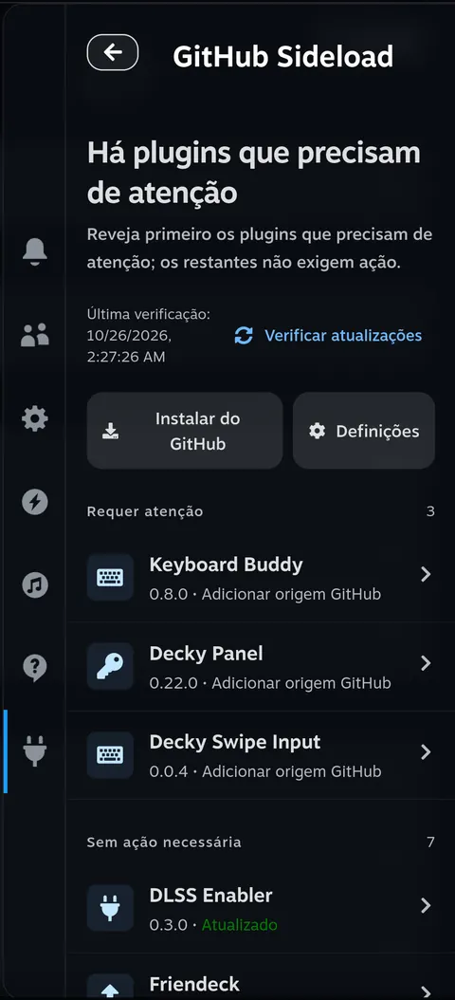
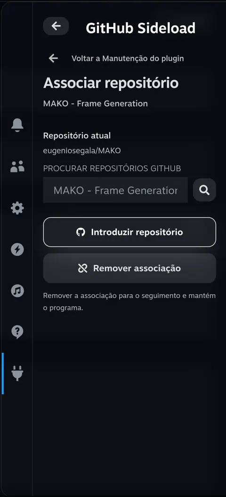
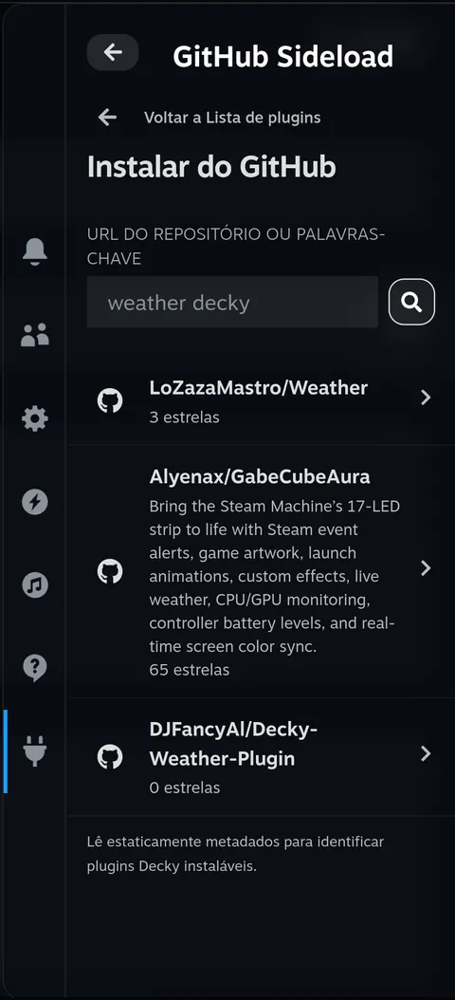
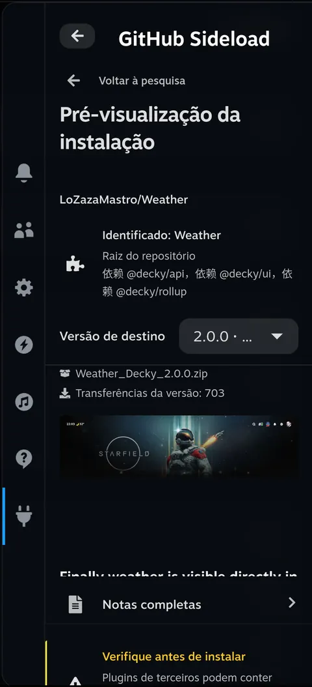
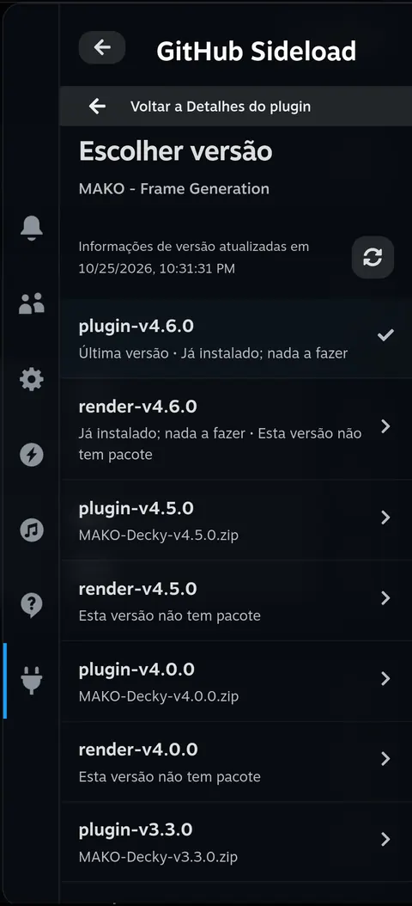
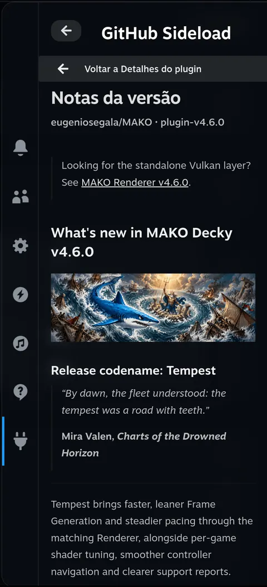
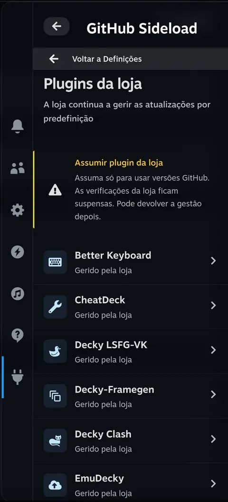
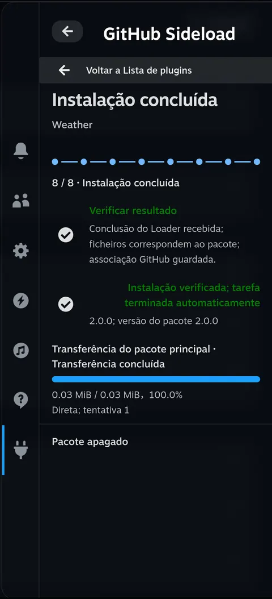
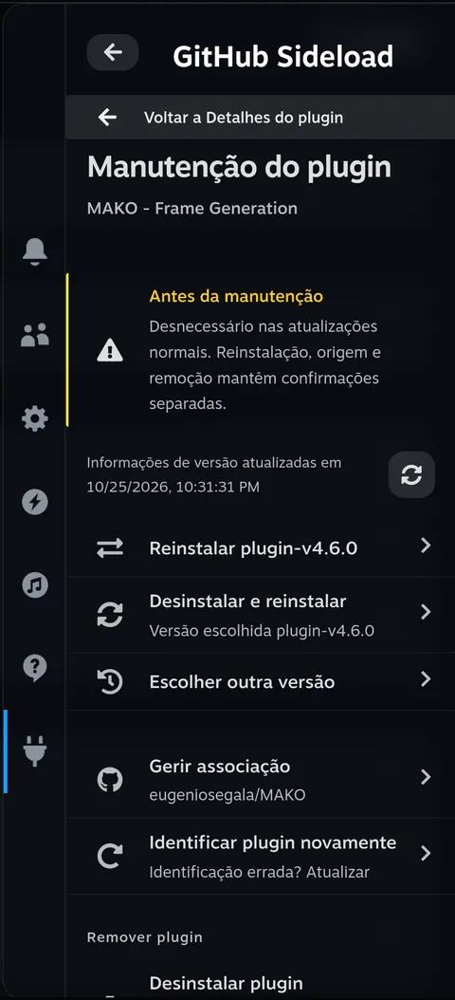

<h1 align="center">decky-sideloader</h1>

O decky-sideloader é um plugin do Decky para o Steam Deck. Associa os plugins instalados aos respetivos repositórios GitHub, verifica versões e permite instalar, atualizar, regressar a uma versão anterior ou reinstalar através das confirmações do próprio Decky. Pesquisa um novo plugin ou cola o endereço do repositório e escolhe a versão e o pacote no menu de acesso rápido (QAM).

<p align="center">
  <a href="../../README.md">English</a> · <a href="./README.zh-CN.md">简体中文</a> · <a href="./README.pt.md">Português</a> · <a href="./README.es.md">Español</a> · <a href="./README.ja.md">日本語</a> · <a href="./README.ko.md">한국어</a>
</p>
<p align="center">
  <a href="#what">O que podes fazer</a> · <a href="#why">Porquê o decky-sideloader</a> · <a href="#install">Instalação</a> · <a href="#try-it">Primeira utilização</a> · <a href="#limits">Instalação e cópias de segurança</a> · <a href="#usage">Utilização e definições</a> · <a href="#language">Idioma</a> · <a href="#development">Informação para programadores</a> · <a href="../../CHANGELOG.md">Alterações</a>
</p>

<p align="center">
  <a href="../../assets/readme/pt/home.webp"></a>
</p>

<h2 id="what">O que podes fazer</h2>

**Reunir os plugins do GitHub.**

Consulta as versões instaladas e os resultados das verificações numa só lista. Quando faltar uma associação, pesquisa o repositório no GitHub ou introduz o seu endereço. Verifica atualizações manualmente ou ativa verificações periódicas e notificações nas definições. As verificações não instalam atualizações automaticamente.

<details>
<summary>Capturas de ecrã</summary>

<p align="center">
  <a href="../../assets/readme/pt/binding.webp"></a>
</p>
</details>

**Encontrar e instalar um novo plugin.**

Encontra plugins com um URL do GitHub, `owner/repo` ou palavras de pesquisa. O repositório é verificado à procura de ficheiros de plugin Decky; se contiver vários plugins, escolhe o projeto pretendido.

<details>
<summary>Capturas de ecrã</summary>

<table>
  <tr>
    <td align="center"><a href="../../assets/readme/pt/search.webp"></a></td>
    <td align="center"><a href="../../assets/readme/pt/preview.webp"></a></td>
  </tr>
</table>
</details>

**Escolher a versão pretendida.**

Lê as notas da versão, abre o documento Markdown completo, escolhe outra versão ou ignora uma publicação.

<details>
<summary>Capturas de ecrã</summary>

<table>
  <tr>
    <td align="center"><a href="../../assets/readme/pt/versions.webp"></a></td>
    <td align="center"><a href="../../assets/readme/pt/release-notes.webp"></a></td>
  </tr>
</table>
</details>

**Separar a gestão da loja.**

Os plugins da loja continuam sob a sua gestão por predefinição. Podes transferir explicitamente a gestão para o decky-sideloader para usar versões do GitHub e, mais tarde, devolvê-la à loja.

<details>
<summary>Capturas de ecrã</summary>

<p align="center">
  <a href="../../assets/readme/pt/store.webp"></a>
</p>
</details>

**Acompanhar a instalação.**

Acompanha a transferência principal, as dependências adicionais, a preparação, a confirmação nativa e a verificação na página da tarefa. Podes fechar e reabrir o QAM para seguir a mesma tarefa. As tarefas bem-sucedidas terminam automaticamente após a conclusão pelo Loader e a verificação dos ficheiros instalados.

<details>
<summary>Capturas de ecrã</summary>

<table>
  <tr>
    <td align="center"><a href="../../assets/readme/pt/task.webp"></a></td>
    <td align="center"><a href="../../assets/readme/pt/maintenance.webp"></a></td>
  </tr>
</table>
</details>

<h2 id="why">Porquê o decky-sideloader</h2>

Instalar um plugin do Decky a partir do GitHub obrigava a mudar para o Modo de Ambiente de Trabalho para transferir um ZIP, voltar ao Modo de Jogo, encontrar esse ZIP no Decky Loader e esperar que a instalação terminasse. Era um processo longo, com mudanças de modo só para instalar um plugin.

As atualizações também passavam despercebidas. Muitas vezes só sabíamos que um plugin tinha sido atualizado quando alguém falava disso num vídeo ou num grupo de conversa. Se a nova versão não funcionasse bem, regressar a uma versão anterior ou escolher outra também não era simples.

<h2 id="install">Instalação</h2>

### Instalar primeiro o Decky

Se ainda não tens o Decky, segue as [instruções oficiais de instalação do Decky Loader](https://github.com/SteamDeckHomebrew/decky-loader#installation).

### Obter um pacote de instalação

Cria o ZIP de instalação com [Compilar a partir do código-fonte](#build). O ficheiro fica no diretório `dist/` do repositório: `dist/decky-sideloader-<version>.zip`.

Copia esse ZIP para o Steam Deck e segue os passos abaixo. O arquivo **Source code (zip)** do GitHub contém código-fonte, não um plugin pronto a instalar.

### Instalar no Decky

Os nomes seguintes correspondem à interface inglesa do Decky:

1. Abre o menu de acesso rápido e seleciona o ícone da ficha. Se outro plugin estiver aberto, regressa à lista de plugins do Decky.
2. Seleciona a engrenagem para abrir **Decky Settings**.
3. Em **General**, ativa **Developer mode**.
4. Abre **Developer**. Em **Third-Party Plugins**, seleciona **Browse** junto de **Install Plugin from ZIP File**.
5. Lê a confirmação do Decky e seleciona o ZIP preparado.
6. Regressa à lista de plugins e abre **Sideloader**.

Para atualizar o próprio Sideloader, instala um ZIP mais recente pelo mesmo processo do Decky. Para o remover, usa **Plugins** nas definições do Decky.

<h2 id="try-it">Primeira utilização</h2>

Abre **Sideloader** no QAM e escolhe o percurso adequado.

### Atualizar um plugin instalado

1. Abre o plugin na página inicial. Se faltar o repositório, usa **Gerir associação**, pesquisa ou cola um endereço e seleciona **Guardar associação**.
2. Seleciona **Verificar atualizações** na página inicial ou **Recarregar versões** nos detalhes do plugin.
3. Lê as notas, escolhe a versão pretendida e inicia a sua instalação.

### Instalar um novo plugin

1. Seleciona **Instalar do GitHub** na página inicial.
2. Introduz um URL do GitHub, `owner/repo` ou palavras de pesquisa. Escolhe o repositório e, se necessário, o projeto.
3. Na pré-visualização, escolhe a versão e o ZIP de instalação e seleciona **Continuar instalação**.

### Confirmar e acompanhar a instalação

Segue as indicações para iniciar a preparação. Quando terminar, confirma a instalação na janela nativa do Decky. A página da tarefa mostra o progresso e o resultado; após a conclusão, regressa à lista de plugins.

Usa **A** para ativar um item e **B** para voltar. Os rascunhos, versões escolhidas e estado da tarefa mantêm-se ao fechar e reabrir o QAM.

<h2 id="limits">Instalação e cópias de segurança</h2>

### Antes de instalar

- A pré-visualização apresenta o aviso sobre código de terceiros e a sua origem. Se o projeto declarar `root`, mostra também **«Este plugin tem acesso total ao teu Steam Deck.»** Este aviso não aparece nos detalhes dos plugins já instalados.
- É necessário um ZIP preparado para instalação. Uma publicação sem pacote continua visível, mas a pré-visualização não escolhe uma versão anterior automaticamente. Em repositórios com vários plugins, escolhe o projeto; o ZIP transferido é verificado em relação a esse projeto.

### Cancelar e desinstalar primeiro

- Podes cancelar enquanto a preparação ainda puder ser interrompida. Uma instalação já iniciada pelo Loader não pode ser interrompida aqui. Resultados falhados ou desconhecidos não contam como instalações concluídas.
- **Desinstalar e reinstalar** prepara o pacote e a cópia antes de pedir autorização para remover. A confirmação do Decky segue-se à verificação da remoção. A rotina de desinstalação do próprio plugin pode alterar os seus dados.

### Conteúdo e localização das cópias

Antes de substituir um plugin, são copiados os diretórios Decky padrão `settings/<folder>` e `data/<folder>`. Os caminhos personalizados não estão incluídos; não há restauro nem reversão automática.

A página da tarefa mostra os dados copiados e onde a cópia foi guardada. A localização habitual é:

```text
~/homebrew/data/decky-sideloader/installations/<operation-id>/data-backup.zip
```

### Conservação e limpeza

- As cópias com mais de sete dias são eliminadas ao iniciar o plugin, a cada hora e antes de preparar uma instalação.
- **Definições → Eliminar cópias de segurança** também elimina cópias recentes após confirmação. As tarefas ativas ou com resultado desconhecido mantêm as suas cópias.
- A limpeza elimina apenas as cópias, não os dados originais nem os pacotes de instalação. A eliminação do pacote após instalar é uma opção separada.

<details>
<summary>Limites dos pacotes e do armazenamento</summary>

| Elemento | Limite |
| --- | --- |
| ZIP principal do plugin | 128 MiB |
| Conteúdo descomprimido | 512 MiB e 10.000 ficheiros |
| Cada cópia de dados | 512 MiB e 10.000 ficheiros |
| Dados de tarefas existentes | Acima de 768 MiB, não é possível iniciar uma nova tarefa |

</details>

<h2 id="usage">Utilização e definições</h2>

### Escolher versões

Os detalhes mantêm a última lista obtida com sucesso até a recarregares ou verificares atualizações. Recarregar preserva a seleção se continuar válida; usa **Escolher outra versão** para mudar para uma versão recém-encontrada.

### Manutenção e gestão da loja

Abre **Manutenção do plugin** nos detalhes para reinstalar a mesma versão, desinstalar e reinstalar, alterar a associação ou remover o plugin. As atualizações normais usam as ações de versão nos detalhes.

Para usar uma versão GitHub num plugin da loja, abre **Definições → Plugins da loja** e assume explicitamente a gestão. Isto suspende as verificações nativas da loja. **Devolver à loja** restaura a definição de atualizações anterior.

<details>
<summary>Definições de ligação</summary>

Abre **Definições → Ligação de rede**. A ligação direta é a predefinição.

- **Apenas ligação direta:** liga diretamente ao GitHub.
- **Alternativa automática:** tenta a ligação direta, GH-Proxy e depois GHFast nas transferências de ficheiros compatíveis.
- **Só GH-Proxy:** usa GH-Proxy.
- **GHFast (ficheiros):** acelera ficheiros compatíveis; a API do GitHub usa ligação direta com GH-Proxy como alternativa.

Os modos de terceiros mostram o endereço e exigem consentimento antes de guardar. Não alteram o proxy do sistema; a tarefa ativa mantém o modo inicial. Para limites do GitHub, respeita a hora de nova tentativa apresentada no erro.

</details>

<details>
<summary>Partilhar registos de diagnóstico</summary>

**Como descarregar**

Abre **Definições → Comentários / registos** e seleciona **Gerar QR de transferência**. Descarrega o ZIP num telefone ou computador na mesma rede local de confiança. A partilha só começa quando pedida; não há envio automático para um serviço remoto.

**Prazo e conservação**

A ligação usa HTTP sem encriptação e expira após cinco minutos ou três transferências completas. Podes pará-la antes.

| Elemento | Limite |
| --- | --- |
| Registos guardados | 4 MiB |
| Cada pacote de diagnóstico | 6 MiB |
| Pacotes conservados | Os três mais recentes |

**Informação incluída e excluída**

- Nomes, repositórios e etiquetas usam identificadores pseudónimos.
- Só ao pedir o pacote são recolhidos a versão do Steam em execução, versão/compilação do sistema, kernel legível, arquitetura da CPU e fabricante/modelo não exclusivos, incluindo Steam Deck LCD/OLED. Abrir o diagnóstico ou atualizar o estado não inicia a recolha.
- Excluem-se mensagens originais, URLs completos, caminhos locais, credenciais e ficheiros do utilizador.
- Excluem-se nomes de anfitrião, números de série, UUIDs, endereços MAC e contas.

**Conteúdo técnico**

Inclui códigos de erro e posições no código seguros, eventos RPC/rede/tarefa correlacionados, progresso separado das dependências, dados de gestão/bloqueio e limpeza, opções operacionais e impressões digitais independentes de frontend/backend. A exportação lê o estado existente, sem atualizar repositórios nem continuar tarefas.

</details>

<h2 id="language">Idioma</h2>

A interface segue o idioma do Steam até escolheres outro. **Language / 语言** aparece no fundo da página inicial e das definições e oferece chinês simplificado, inglês, português, espanhol, japonês e coreano.

A escolha manual é guardada para este plugin. Mudar de idioma mantém a página, os campos preenchidos, a versão selecionada e a tarefa. As notas das versões do GitHub e os documentos de licença de terceiros mantêm os idiomas originais.

Este README está disponível nos mesmos seis idiomas através das ligações no topo.

<h2 id="development">Informação para programadores</h2>

<details id="build">
<summary>Compilar a partir do código-fonte</summary>

São necessários Node.js, pnpm, Bun e Python 3. Executa estes comandos na raiz do repositório:

```sh
pnpm install --frozen-lockfile
pnpm typecheck
pnpm test
pnpm test:python
pnpm build
```

Depois de compilar, cria o ZIP de instalação:

```sh
pnpm package-plugin
```

O ZIP inclui a interface, o backend Python, os avisos de licença e os seis READMEs. Não acrescentes definições do dispositivo, registos ou cópias de segurança.

O resultado é `dist/decky-sideloader-<version>.zip`. O código do backend fica em `backend/main.py` e nos módulos por funcionalidade de `backend/sideload/`; o empacotamento coloca-os em `main.py` e `py_modules/sideload/`, conforme exigido pelo Loader. Não copies diretamente a estrutura do código-fonte para o dispositivo.

O workflow do GitHub em `.github/workflows/build.yml` valida e compila pull requests e envios para `main`, disponibilizando o ZIP de instalação como artefacto. Enviar uma etiqueta `v<version>` que corresponda ao `package.json` também publica uma GitHub Release com esse ZIP e a secção completa em inglês e chinês da versão no `CHANGELOG.md`.

</details>

## Licença

[BSD 3-Clause](../../LICENSE). Copyright (c) 2026, zacharym. Direitos de autor do modelo original: Copyright (c) 2022–2024, Steam Deck Homebrew.

Os componentes de terceiros mantêm as respetivas licenças. Consulta os avisos incluídos em **Definições → Licenças de código aberto**.
