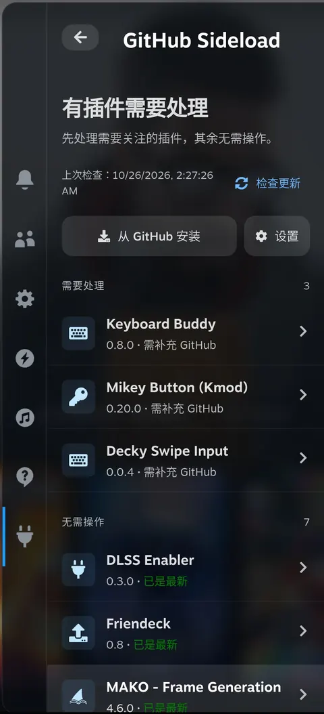
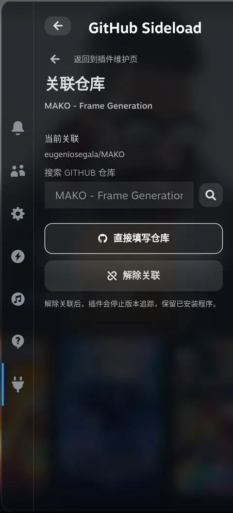
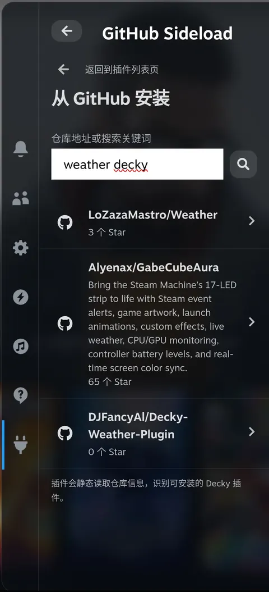
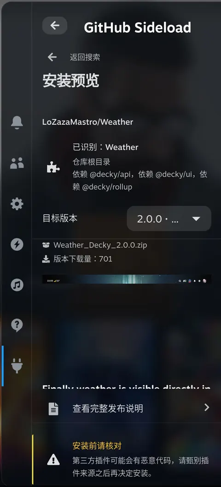
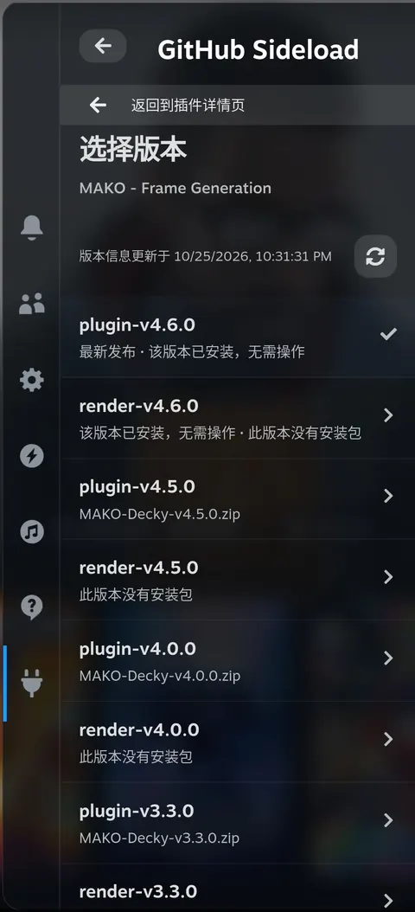
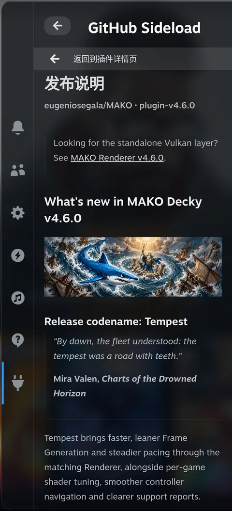
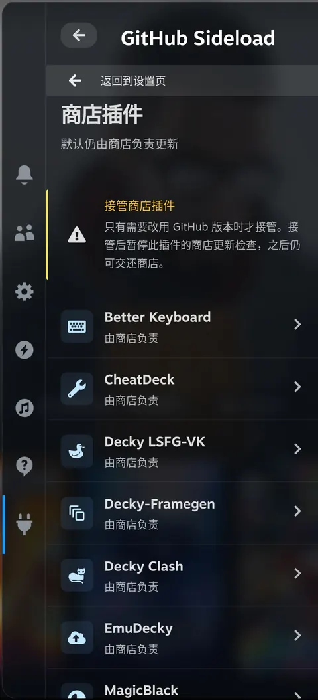
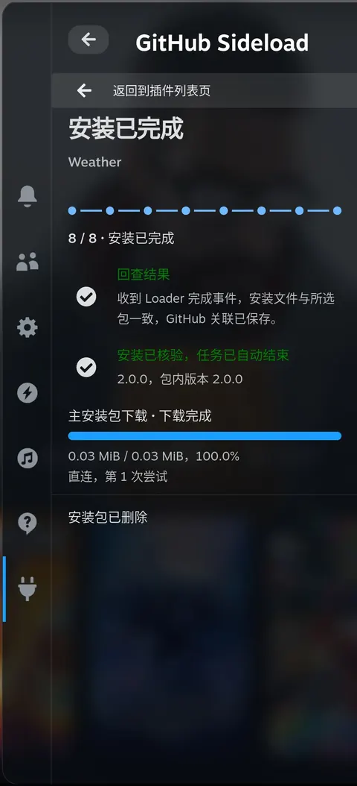
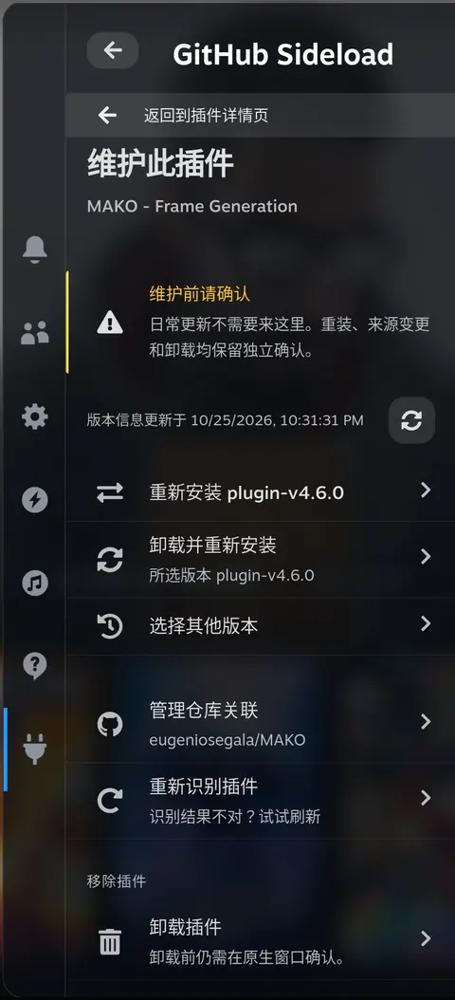

<h1 align="center">decky-sideloader</h1>

decky-sideloader 是 Steam Deck 的 Decky 插件。它将已安装插件与 GitHub 仓库关联，在 Decky 原生确认流程中完成安装、更新、降级或重装。你可以在快捷访问菜单（QAM）中搜索新插件或粘贴仓库地址，再选择发布版本和安装包。

<p align="center">
  <a href="../../README.md">English</a> · <a href="./README.zh-CN.md">简体中文</a> · <a href="./README.pt.md">Português</a> · <a href="./README.es.md">Español</a> · <a href="./README.ja.md">日本語</a> · <a href="./README.ko.md">한국어</a>
</p>
<p align="center">
  <a href="#what">可以做什么</a> · <a href="#why">为什么做 decky-sideloader</a> · <a href="#install">安装</a> · <a href="#try-it">首次使用</a> · <a href="#limits">安装与备份</a> · <a href="#usage">使用与设置</a> · <a href="#language">语言</a> · <a href="#development">开发者信息</a> · <a href="../../CHANGELOG.md">更新记录</a>
</p>

<p align="center">
  <a href="../../assets/readme/zh-cn/home.webp"></a>
</p>

<h2 id="what">可以做什么</h2>

**集中管理 GitHub 插件。**

在同一个列表查看已安装版本和更新结果。缺少仓库关联时，可以搜索 GitHub 或填写地址。既可以手动检查更新，也可以在设置中开启定时检查和通知。检查更新不会自动安装。

<details>
<summary>截图</summary>

<p align="center">
  <a href="../../assets/readme/zh-cn/binding.webp"></a>
</p>
</details>

**查找并安装新插件。**

通过 GitHub URL、`owner/repo` 或关键词查找插件。decky-sideloader 会先检查仓库中的 Decky 插件文件；同一仓库有多个插件时，可以选择需要的项目。

<details>
<summary>截图</summary>

<table>
  <tr>
    <td align="center"><a href="../../assets/readme/zh-cn/search.webp"></a></td>
    <td align="center"><a href="../../assets/readme/zh-cn/preview.webp"></a></td>
  </tr>
</table>
</details>

**选择需要的发布版本。**

阅读发布说明、打开完整 Markdown 文档、选择其他版本，或跳过某次发布。

<details>
<summary>截图</summary>

<table>
  <tr>
    <td align="center"><a href="../../assets/readme/zh-cn/versions.webp"></a></td>
    <td align="center"><a href="../../assets/readme/zh-cn/release-notes.webp"></a></td>
  </tr>
</table>
</details>

**将商店管理与 GitHub 管理分开。**

商店管理的插件默认继续由商店负责。需要使用 GitHub 版本时，可以明确转交给 decky-sideloader 管理，之后也能交还商店。

<details>
<summary>截图</summary>

<p align="center">
  <a href="../../assets/readme/zh-cn/store.webp"></a>
</p>
</details>

**跟踪安装进度。**

在任务页查看主包、额外依赖的下载，以及准备、原生确认和核验进度。关闭 QAM 后可以重新打开，继续查看同一个任务。Loader 完成安装且文件核验通过后，成功任务自动结束。

<details>
<summary>截图</summary>

<table>
  <tr>
    <td align="center"><a href="../../assets/readme/zh-cn/task.webp"></a></td>
    <td align="center"><a href="../../assets/readme/zh-cn/maintenance.webp"></a></td>
  </tr>
</table>
</details>

<h2 id="why">为什么做 decky-sideloader</h2>

安装 GitHub 上的 Decky 插件，原本要先切到桌面模式下载 ZIP，再切回游戏模式，到 Decky Loader 里找到压缩包，然后等待安装完成。流程长，还得来回切换模式。

插件更新了，我们却不容易知道，常常是在视频网站或群里看到有人提起，才知道出了新版。新版如果不好用，想换回旧版或切换到其他版本也不方便。

<h2 id="install">安装</h2>

### 先安装 Decky

如果尚未安装 Decky，请按照官方的 [Decky Loader 安装说明](https://github.com/SteamDeckHomebrew/decky-loader#installation)操作。

### 获取安装包

按[从源码构建](#build)生成安装 ZIP。产物位于仓库的 `dist/` 目录：`dist/decky-sideloader-<version>.zip`。

将这个 ZIP 复制到 Steam Deck，再按下方步骤安装。GitHub 的 **Source code (zip)** 包含源码，不是可直接安装的插件包。

### 在 Decky 中安装

以下使用 Decky 英文界面的菜单名称：

1. 打开快捷访问菜单并选择插头图标。如果已打开其他插件，先返回 Decky 插件列表。
2. 点击齿轮，打开 **Decky Settings**。
3. 在 **General** 中开启 **Developer mode**。
4. 打开 **Developer**，在 **Third-Party Plugins** 下找到 **Install Plugin from ZIP File**，点击旁边的 **Browse**。
5. 阅读 Decky 的确认内容并选择打包好的 ZIP。
6. 返回插件列表，打开 **Sideloader**。

更新 Sideloader 本身时，用同样的 Decky 流程安装新版 ZIP。卸载本插件请使用 Decky 设置中的 **Plugins**。

<h2 id="try-it">首次使用</h2>

在 QAM 中打开 **Sideloader**，按需要选择下面一条路径。

### 更新已有插件

1. 从首页打开目标插件。缺少仓库关联时，进入“管理仓库关联”，搜索或粘贴地址，再点击“保存关联”。
2. 在首页点击“检查更新”，或在插件详情点击“重新读取版本”。
3. 阅读发布说明，选择需要的版本并发起安装。

### 安装新插件

1. 在首页选择“从 GitHub 安装”。
2. 输入 GitHub URL、`owner/repo` 或搜索关键词，选择仓库；仓库包含多个插件时，再选择具体项目。
3. 在安装预览中选择版本与安装 ZIP，点击“继续安装”。

### 确认并查看安装结果

按页面提示开始准备。准备完成后，在 Decky 弹出的原生窗口确认安装。任务页会显示进度和结果，完成后返回插件列表。

按 **A** 激活条目，按 **B** 返回。搜索草稿、版本选择和任务状态会在关闭并重新打开 QAM 后保留。

<h2 id="limits">安装与备份</h2>

### 安装前确认

- 新装预览提示第三方代码与来源风险。所选项目声明 `root` 时，还会显示“**此插件可以完全访问你的 Steam Deck。**”已安装插件详情不显示此提示。
- 发布版本需要包含打包好的插件 ZIP。没有安装包的发布仍可查看，但预览不会自动改选旧版本。同一仓库有多个插件时，需要选择具体项目；下载后的 ZIP 会再与所选项目核对。

### 取消与卸载重装

- 准备阶段仍可安全停止时可以取消；Loader 已开始的安装不能在这里中断。失败或结果未知不会被当成安装完成。
- “卸载并重新安装”先准备安装包和备份，再请求卸载许可；确认移除后，才进入 Decky 安装确认。目标插件自身的卸载钩子可能修改其数据。

### 备份内容与保存位置

替换已有插件前，会备份其 Decky 标准 `settings/<folder>` 和 `data/<folder>` 目录。不包含自定义路径，也不自动恢复或回滚。

可以在任务页查看这次备份包含哪些数据，以及备份文件保存在哪里。通常位于：

```text
~/homebrew/data/decky-sideloader/installations/<operation-id>/data-backup.zip
```

### 保留与清理规则

- 超过七天的备份会在插件启动、每小时及准备新安装前自动删除。
- “设置 → 清理数据备份”经确认后也会删除近期备份；活动任务与结果未知任务的备份保留。
- 清理只删除备份归档，不删除原插件数据或安装包。“安装完成后删除安装包”仍是独立设置。

<details>
<summary>安装包与存储限制</summary>

| 对象 | 限制 |
| --- | --- |
| 下载的主插件 ZIP | 最大 128 MiB |
| 解压后的插件内容 | 最大 512 MiB，最多 10,000 个文件 |
| 单个数据备份 | 最大 512 MiB，最多 10,000 个文件 |
| 已有任务数据 | 超过 768 MiB 时，不能开始新任务 |

</details>

<h2 id="usage">使用与设置</h2>

### 版本选择

详情保留上次成功读取的版本列表，直到你重新读取或执行更新检查。刷新会保留仍有效的所选版本；要切换到刚查到的新版本，请使用“选择其他版本”。

### 插件维护与商店管理

在插件详情进入“维护此插件”，可以同版重装、卸载并重新安装、更改仓库关联或移除插件。日常更新直接使用详情中的版本操作。

需要让商店插件使用 GitHub 版本时，进入“设置 → 商店插件”，明确接管目标插件；接管后暂停其原生商店更新检查。“交还商店”会恢复接管前的商店更新设置。

<details>
<summary>连接设置</summary>

进入“设置 → 网络连接”。默认使用直连。

- **仅直连**：直接连接 GitHub。
- **自动备用**：先直连，再尝试 GH-Proxy；对支持的文件下载，还会尝试 GHFast。
- **仅 GH-Proxy**：通过 GH-Proxy 连接。
- **GHFast（文件加速）**：加速支持的文件下载；GitHub API 请求仍使用直连，并以 GH-Proxy 备用。

第三方模式会在保存前展示服务地址并要求同意，不修改系统代理。进行中的任务继续使用开始时的模式。GitHub 提示限流时，按错误中显示的时间重试。

</details>

<details>
<summary>分享诊断日志</summary>

**如何下载**

进入“设置 → 问题反馈 / 诊断日志”，点击“生成下载二维码”。用同一可信局域网内的手机或电脑下载 ZIP。分享仅在主动请求时启动，不会自动将日志发送到远程服务。

**分享期限与保留数量**

链接使用未加密的 HTTP，五分钟或三次完整传输后失效，也可以提前停止。

| 对象 | 限制 |
| --- | --- |
| 日志总量 | 4 MiB |
| 单份诊断包 | 6 MiB |
| 保留的诊断包 | 最近三份 |

**包含与不包含的信息**

- 名称、仓库与版本标签使用匿名标识。
- 仅在请求生成诊断包时采集设备信息：运行中的 Steam 客户端版本、系统版本／构建号、可读内核版本、CPU 架构，以及非唯一的硬件厂商／型号，包含 Steam Deck LCD／OLED 识别。打开诊断页或刷新状态不会触发采集。
- 不包含原始错误文本、完整 URL、本地路径、凭据或用户文件。
- 不包含主机名、序列号、UUID、MAC 地址或账号信息。

**技术内容**

诊断包包含安全错误码与源码位置、相互关联的 RPC／网络／任务事件、独立依赖进度、管理归属／冻结与清理结果、必要运行开关及独立前后端构建指纹。导出只读取已有状态，不刷新仓库或继续任务。

</details>

<h2 id="language">语言</h2>

未手动选择时，界面跟随 Steam 的语言。首页与设置底部都有“**Language / 语言**”，支持简体中文、英语、葡萄牙语、西班牙语、日语和韩语。

手动选择会为本插件单独记忆。切换语言保留当前页面、输入、所选版本和任务。GitHub 发布说明及第三方许可证文档保留原语言。

本 README 同样提供六种语言，可通过顶部链接切换。

<h2 id="development">开发者信息</h2>

<details id="build">
<summary>从源码构建</summary>

需要 Node.js、pnpm、Bun 和 Python 3。在仓库根目录运行：

```sh
pnpm install --frozen-lockfile
pnpm typecheck
pnpm test
pnpm test:python
pnpm build
```

构建后生成安装 ZIP：

```sh
pnpm package-plugin
```

ZIP 包含前端、Python 后端、许可证材料和六种语言的 README。不要把设备设置、日志或备份放进去。

产物为 `dist/decky-sideloader-<version>.zip`。后端源码位于 `backend/main.py` 与按功能划分的 `backend/sideload/`；打包时映射为 Loader 要求的 `main.py` 和 `py_modules/sideload/`，不要把源码目录结构直接复制到设备。

`.github/workflows/build.yml` 中的 GitHub workflow 对 Pull Request 和推送到 `main` 的代码执行检查、构建并上传安装 ZIP。推送与 `package.json` 版本一致的 `v<version>` 标签时，还会创建 GitHub Release，附上 ZIP，正文使用 `CHANGELOG.md` 对应版本完整的英语／中文章节。

</details>

## 许可证

[BSD 3-Clause](../../LICENSE)。Copyright (c) 2026, zacharym。原始模板版权：Copyright (c) 2022–2024, Steam Deck Homebrew。

第三方组件保留各自许可证。可在“设置 → 开源许可”阅读随包提供的许可材料。
